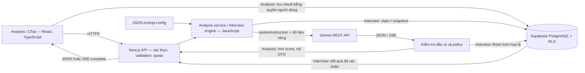
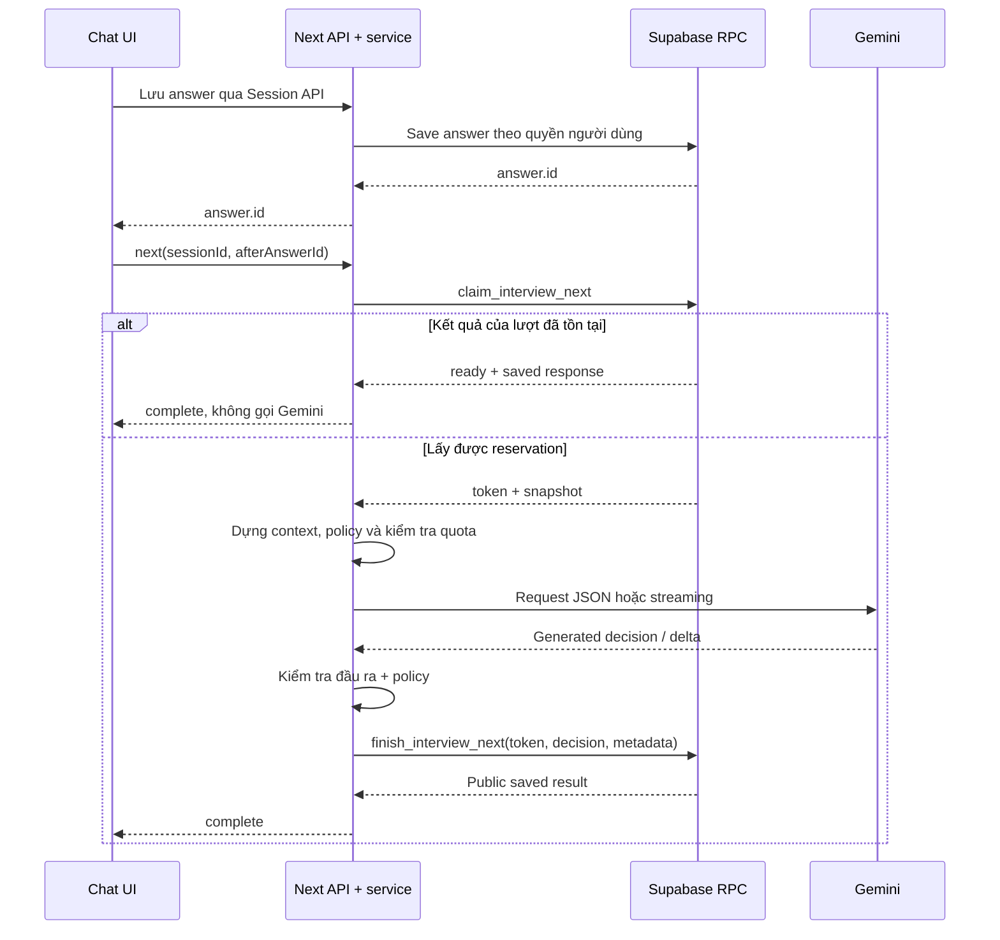

# InterviewBuddy — Thiết kế phần AI

| Thuộc tính | Giá trị |
|---|---|
| Task | [SCRUM-125](https://nhom3-24c01-se.atlassian.net/browse/SCRUM-125) — AI design document: prompts, JSON schemas, decision logic |
| Phiên bản tài liệu | 1.0 — bản soạn để review, ngày 13/11/2026 |
| Phụ trách nội dung | Lâm Gia Hưng; tài liệu được soạn và đối chiếu bằng Codex |
| Người review theo Jira | Nhân, vai trò AI backup; **chưa thực hiện review hoặc xác nhận chấp thuận** |
| Mã nguồn được mô tả | `469bfbf8b2f8e0e39710087c57911e266b6e36e9`, nhánh `feat/scrum-124-prompt-config-hung`, [PR #31](https://github.com/TrungNhan8386/InterviewBuddy/pull/31) |
| Main đã fetch trước task | `0668228`; chưa chứa chuỗi thay đổi SCRUM-121/122/123/124 tại thời điểm đối chiếu |
| Nhánh soạn tài liệu | `docs/scrum-125-ai-design-hung`, kế thừa bản SCRUM-124 để mô tả đầy đủ phần bàn giao |

## 1. Mục đích và phạm vi

Nhóm thiết kế hai luồng AI đang có mã triển khai: phân tích mức độ phù hợp CV/JD và sinh câu hỏi cho một phiên phỏng vấn. Tài liệu này giải thích dữ liệu đi qua từng thành phần, lời hướng dẫn gửi model, cấu trúc kết quả, quyết định do chương trình thực thi và cách khôi phục khi một bước thất bại. Nhân có thể dùng tài liệu cùng [checklist review](ai-design-review.md) để kiểm tra và tiếp quản phần AI.

Đây là mô tả bản mã nguồn nêu trên, không phải xác nhận chuỗi PR đã vào main hoặc deployment đã chạy phiên bản đó. Chức năng feedback sau từng câu, báo cáo đánh giá cuối phiên và cách sửa câu trả lời đã lưu chưa được tài liệu này bổ sung vào sản phẩm. Các điểm chưa đáp ứng use case được giữ ở mục 10, không viết thành chức năng đã hoàn thành.

Các ví dụ dưới đây là dữ liệu tổng hợp. Bản đầy đủ, dùng được cho kiểm chứng offline, nằm trong [examples.json](ai-design/examples.json). Không có CV người dùng, API key, mật khẩu, access token hoặc session ID thật trong ví dụ.

## 2. Thành phần và ranh giới trách nhiệm

| Thành phần | Công nghệ / nơi chạy | Trách nhiệm |
|---|---|---|
| Analysis và Chat UI | React, TypeScript/TSX, Tailwind CSS; trình duyệt | Nhận CV/JD/câu trả lời, chọn ngôn ngữ, hiển thị kết quả/lỗi và bản nháp streaming. |
| API và xác thực | Next.js Route Handlers, TypeScript/JavaScript; Node.js server | Kiểm tra người dùng, hợp đồng request, hạn mức và điều phối service. |
| Analysis service | JavaScript ESM `.mjs`; server | Gọi provider, kiểm tra yêu cầu/bằng chứng/coaching, tính fit score bằng công thức xác định. |
| Interview engine | JavaScript ESM `.mjs`; server | Dựng context từ database, chọn đoạn JD/CV, rút lịch sử, áp chính sách hành động, kiểm tra quyết định AI. |
| Prompt configuration | JSON, static imports vào server bundle | Chứa lời hướng dẫn chung, ngôn ngữ, vòng phỏng vấn và độ khó; không chứa dữ liệu ứng viên. |
| Gemini provider | REST `generateContent` / `streamGenerateContent`; server gọi dịch vụ Google | Sinh JSON từ lời hướng dẫn và dữ liệu. Không tự quản lý lượt trong database hoặc tính điểm phần trăm. |
| Persistence và Auth | Supabase Auth, PostgreSQL/SQL, RLS | Quyền sở hữu, kết quả Analysis đã lưu, câu hỏi/câu trả lời, đặt chỗ lượt sinh và replay. |



Trong luồng API Next.js, cả Analysis và Interview đều cần người dùng đã đăng nhập và kiểm tra hạn mức bằng client Supabase theo quyền người dùng. `server.mjs` là API Analysis standalone dùng cho phát triển/kiểm thử: nó không tự bọc lớp sign-in và daily limit như Route Handlers của ứng dụng. Không dùng kết quả standalone làm bằng chứng Auth/RLS hoặc đưa cổng đó ra Internet như một endpoint sản phẩm đã được bảo vệ.

Nguồn: [Analysis routes](../../src/app/api/analyze-fit/route.js), [signed-in wrapper](../../src/lib/ai/signed-in-analysis-route.mjs), [Interview route](../../src/app/api/interview/next/route.ts), [Auth adapter](../../src/lib/interview/http.ts), [standalone](../../src/server.mjs).

## 3. Luồng phân tích CV/JD

1. Người dùng dán CV hoặc chọn PDF. `/api/extract-cv` dùng `pdf-parse` trên Node.js để đọc text trong bộ nhớ; file PDF không được route này lưu lại. Bản text và kết quả có thể được lưu ở bước Analysis riêng.
2. UI gửi `{jd, cv, language}` đến `/api/analyze-fit`. API kiểm tra sign-in, chuẩn hóa và kiểm tra độ dài/ngôn ngữ trước khi tiêu thụ hạn mức.
3. Provider thực hiện một lần `generateContent`: `systemInstruction` lấy từ cấu hình; `contents` chỉ chứa JSON `{cvText, jdText}`. API key chỉ ở header `x-goog-api-key` phía server.
4. Provider yêu cầu `STOP`, bỏ thought parts, parse JSON; `scoreAnalysis` tiếp tục kiểm tra dữ liệu, bằng chứng và coaching. Không tự retry model khi JSON sai.
5. Code chuẩn hóa tên/alias kỹ năng, loại trùng và tính điểm. Adapter đổi kết quả sang hợp đồng UI. API phân tích không tự insert `fit_analyses`.
6. `AnalysisWorkspace` nhận kết quả rồi gọi `saveFitAnalysis` từ trình duyệt, lưu qua Supabase/RLS. Nếu chỉ lưu thất bại, UI giữ kết quả và cho “Lưu lại”; thao tác này không cần gọi Gemini thêm.

Nguồn: [PDF extraction](../../src/app/api/extract-cv/route.ts), [Analysis service](../../src/lib/analysis/service.mjs), [HTTP contract](../../src/lib/analysis/http.mjs), [adapter](../../src/lib/analysis/analysis-fit.mjs), [UI workspace](../../src/components/analysis/AnalysisWorkspace.tsx), [storage](../../src/lib/analysis/storage.ts).

### 3.1 Giới hạn dữ liệu theo từng lớp

| Lớp | Giới hạn đang có |
|---|---|
| PDF extraction | Tối đa 5 MB; dưới 50 ký tự sau làm sạch trả `noText`; hơn 20.000 ký tự cắt text và trả `truncated`, `originalChars`; không giới hạn theo số trang. |
| `/api/analyze-fit` | CV 30–50.000 ký tự; JD 30–3.000; mặc định ngôn ngữ `vi`, hỗ trợ `vi`/`en`. |
| `/api/analyze` core | CV 30–50.000; JD 30–30.000; body tối đa 400.000 byte; chỉ nhận `cvText`, `jdText`, `language`. |
| Kết quả model | Tối đa 40 requirement trước loại trùng; generationConfig Analysis có `maxOutputTokens: 8192`. |

Giới hạn ký tự ở JavaScript dựa trên `.length`, không phải token Gemini. Trần 50.000 của core không làm mất trần extraction 20.000 hoặc JD UI 3.000. Nhân cần kiểm tra cả cờ cắt text và nội dung đuôi PDF khi đánh giá CV dài. PDF scan không có OCR trong route đang mô tả; UI hướng dẫn dán text.

### 3.2 JSON schema và kiểm tra nghiệp vụ Analysis

Schema gửi Gemini được định nghĩa ở [GEMINI_ANALYSIS_SCHEMA](../../src/lib/analysis/contracts.mjs). Bản chụp đầy đủ cho reviewer: [analysis-output.schema.json](ai-design/analysis-output.schema.json). Bản chụp là tài liệu, ứng dụng vẫn sử dụng export trong code.

| Trường | Kiểu / ý nghĩa | Kiểm tra bổ sung trong code |
|---|---|---|
| `requirements` | Mảng kỹ năng JD; mỗi phần tử có `skill`, `importance`, `matched`, `jdEvidence`, `cvEvidence`, `reason` | Tối đa 40; tên ≤160, JD/CV evidence ≤1.500, reason ≤1.200 ký tự; importance là `required`/`preferred`. |
| `matched` | Boolean, không có mức partial do engine này sinh | Match phải có CV evidence; unmatched bắt buộc evidence CV rỗng. |
| `jdEvidence`, `cvEvidence` | Trích dẫn hỗ trợ kết luận | Kiểm tra substring sau NFKC, chuẩn hóa whitespace và chữ thường; không phải phép chứng minh ngữ nghĩa hoặc xác minh kinh nghiệm thực tế. |
| `summary` | Nhận xét ngôn ngữ được chọn | Chuỗi không rỗng, tối đa 2.000 ký tự; kiểm tra các mẫu xúc phạm đã định nghĩa. |
| `coaching` | `beforeInterview`, `improvements`, `strengths`; mỗi item gồm `skill`, `advice` | Mỗi mảng tối đa 3, không lặp kỹ năng; skill phải liên kết với requirements. Advice preparation/strength ≤900, improvements ≤500 ký tự. |

Các object không cho trường ngoài hợp đồng. Requirement nhãn nhân khẩu học thuộc mẫu được nhận diện bị từ chối. `beforeInterview` dùng kỹ năng chưa được chứng minh; nếu không có gap thì có thể dùng kỹ năng đã match. Khi có gap, preparation và improvements không được rỗng; strengths chỉ nhận skill đã match và bắt buộc có khi có matched skill. Nếu không có requirement đánh giá được, trả `NO_JOB_REQUIREMENTS`/422 thay vì cho điểm 0 hoặc 100.

Prompt yêu cầu 2–3 câu nhận xét kỹ thuật cụ thể, đọc phủ định, không bịa dự án/số liệu và dùng evidence đúng nguồn. Validator chỉ kiểm tra một phần các yêu cầu này; không tự chấm được độ chuyên sâu, mọi phủ định hoặc mọi suy diễn sai.

### 3.3 Công thức fit score và ví dụ

Code đặt trọng số `required = 2`, `preferred = 1`. Sau chuẩn hóa alias và loại trùng:

```text
totalWeight   = tổng trọng số của mọi requirement
matchedWeight = tổng trọng số của requirement có matched = true
fitScore      = round(10000 × matchedWeight / totalWeight) / 100
```

Ví dụ tổng hợp dùng cùng dữ liệu trong `examples.json`:

```json
{
  "jd": "React is required. Git is preferred for version control.",
  "cv": "I built React components with automated unit tests.",
  "language": "en"
}
```

Giả sử model trả React required/matched và Git preferred/missing, với các trích dẫn hợp lệ: `matchedWeight = 2`, `totalWeight = 3`, kết quả core là **66,67%**. UI và cột `fit_score` khi lưu làm tròn thành **67**; JSON `result` giữ số 66,67. Alias trùng không tăng mẫu số hai lần; khi gộp giữ mức required mạnh hơn và match có bằng chứng.

Đây là điểm bao phủ yêu cầu kỹ năng theo bằng chứng văn bản, không phải xác suất trúng tuyển hoặc điểm năng lực con người. Kết quả còn phụ thuộc danh sách yêu cầu và match do model đề xuất.

`/api/analyze` trả kết quả core, gồm summary, scoreBreakdown và metadata model/scoring/language/thời điểm; `analysisId` được sinh cho response không tự chứng minh đã có row database. `/api/analyze-fit` trả các trường tương thích UI: `fitScore`, `matched`, `missing`, `requirements`, `recommendation`, `coaching`. UI hiện hiển thị preparation, bảng yêu cầu/trạng thái và strengths; không hiển thị cột evidence hoặc khối improvements, dù dữ liệu tương thích vẫn có trong API. Tên kỹ năng/sản phẩm và evidence nguồn có quy tắc ngôn ngữ riêng.

Nguồn: [scoring](../../src/lib/analysis/scoring.mjs), [result adapter](../../src/lib/analysis/analysis-fit.mjs), [UI result](../../src/components/analysis/FitResult.tsx).

## 4. Luồng phỏng vấn: context, quyết định và lưu lượt

### 4.1 Request công khai khác với context nội bộ

Trình duyệt chỉ gửi `sessionId` và `afterAnswerId` tới `/api/interview/next`; không gửi history, CV/JD, counters hoặc summary để server tin trực tiếp. `afterAnswerId: null` dành cho opening; các lượt tiếp dùng ID câu trả lời vừa lưu. Body tối đa 2.048 byte. Các ID sau là tổng hợp:

```json
{
  "sessionId": "00000000-0000-4000-8000-000000000010",
  "afterAnswerId": "00000000-0000-4000-8000-000000000011"
}
```

Server xác thực, gọi RPC claim và dựng context từ session/questions/answers đã lưu, gồm settings, trạng thái/thời gian và các turn đã có answer. Lịch sử thiếu vị trí/câu trả lời hoặc context quá lớn bị từ chối. Context nội bộ và ví dụ hợp lệ có trong `examples.json`; đây không phải body client được phép tự gửi.

Nguồn: [validateNextRequest / contextFromSnapshot](../../src/lib/interview/next-service.mjs), [next HTTP](../../src/lib/interview/next-http.mjs), [hợp đồng persistence](../api/INTERVIEW_PERSISTENCE_API_v1.md).

### 4.2 Dựng prompt context

| Thành phần | Hành vi hiện tại |
|---|---|
| `questionPlan` | Xếp hạng đoạn JD theo độ phủ từ khóa với câu hỏi/topic cũ; chọn focus ít được kiểm tra, lấy tối đa 2 đoạn CV liên quan bằng overlap. Alias/overlap giúp chọn context, không chứng minh đã có kỹ năng. |
| `difficultyPolicy`, `roundPolicy` | Chọn lời hướng dẫn từ `question-plan.json` theo technical/behavioral/hr và easy/medium/hard. |
| `completedTurns` | Giữ 4 cặp hỏi–đáp hoàn chỉnh gần nhất. |
| `conversationSummary` | Trích xuất coverage và tối đa 6 excerpt của phần cũ, giới hạn khoảng 6.000 ký tự JSON; không gọi LLM tóm tắt thêm. |
| `documents` | Chế độ compact chọn đoạn nguyên văn, có hàng xóm để giữ phủ định/điều kiện; ngân sách CV 4.000, JD 6.000 ký tự. |
| `turnEvidence` | Bổ sung đoạn nguồn liên quan lượt hiện tại chưa có trong projection; ngân sách mỗi nguồn 2.200 ký tự. |
| `documentCoverage` | Ghi complete/originalCharacters/omittedPassages để model biết dữ liệu bị lược; bỏ sót không được coi là thiếu năng lực. |

Các ngân sách projection không phải trần cứng cho mọi văn bản: một passage không ngắt quá dài hoặc trường hợp chọn không có cơ sở có thể giữ nguyên nguồn. `GEMINI_INTERVIEW_CONTEXT_MODE=full` bỏ projection, giữ full documents. Input gốc vẫn qua giới hạn; không xóa dữ liệu session để làm context ngắn đi.

Hợp đồng nội bộ giới hạn JD 30.000, CV 50.000, mỗi answer 12.000, history 48 turn và toàn JSON context 180.000 ký tự. Giới hạn request mẫu 7.000 ký tự trong test là kiểm tra overhead với fixture ngắn, không phải trần toàn request cho mọi phiên.

Nguồn: [question plan](../../src/lib/interview/question-plan.mjs), [memory](../../src/lib/interview/conversation-memory.mjs), [document projection](../../src/lib/interview/document-context.mjs), [input contract](../../src/lib/interview/interviewer-contract.mjs).

### 4.3 Quyết định nào do code, quyết định nào do Gemini?

| Điều kiện | Cách xử lý xác định bằng code | Phần model được chọn |
|---|---|---|
| Session đã đóng | `end`, không gọi Gemini | Không có. |
| Đạt thời lượng hoặc đủ câu chính đã trả lời | `end`, không gọi Gemini | Không có. |
| Chưa có history | Chỉ cho phép `next_topic` | Nội dung câu mở đầu, topic, reason. |
| Đã đạt cap follow-up của chủ đề | Chỉ cho phép `next_topic` | Chọn câu/topic tiếp phù hợp context. |
| Còn lượt follow-up | Cho phép `follow_up` hoặc `next_topic` | Dựa vào ý đã/chưa trả lời để chọn trong hai hành động. |

Settings có thời lượng 15/30/45 phút tương ứng 5/8/12 câu chính. Cap follow-up easy/medium/hard là 1/2/3 cho mỗi chủ đề. Counters dùng **toàn bộ history đã lưu**, không chỉ 4 turn model nhìn thấy. Khi đủ câu chính, policy end được ưu tiên; không bảo đảm luôn hỏi hết cap follow-up ở câu chính cuối.

Chỉ dẫn model: Yes/Dạ có hoặc câu dài nhưng lệch ý cần hỏi một phần còn thiếu khi được phép; không lặp cả checklist. `next_topic` dùng khi từ chối, câu đã giải quyết đúng ý hoặc đạt cap. Technical dùng giả định nếu không có bằng chứng trải nghiệm; behavioral hỏi sự kiện thực quá khứ và khai thác STAR; HR tập trung động lực/giao tiếp liên quan công việc. Đây là chỉ dẫn cần đánh giá chất lượng, không phải điều kiện được validator hiểu hoàn toàn.

### 4.4 JSON schema của quyết định Interview

Nguồn chuẩn: [INTERVIEWER_OUTPUT_SCHEMA và validator](../../src/lib/interview/interviewer-contract.mjs). Bản chụp: [interviewer-output.schema.json](ai-design/interviewer-output.schema.json).

```json
{
  "question": "What should users see while a React request is loading?",
  "action": "follow_up",
  "topic": "React UI states",
  "reason": "Clarify the loading state before moving to another topic."
}
```

| Trường / điều kiện | Validator thực thi |
|---|---|
| Object | Đúng 4 trường, không thêm score/feedback hoặc trường lạ. |
| `action` | Thuộc `follow_up`, `next_topic`, `end` và phải nằm trong `allowedActions` server. |
| `question` | `null` chỉ với end; còn lại không rỗng và ≤1.200 ký tự. |
| `topic` | Không rỗng, ≤160; follow_up phải bằng topic của turn cuối sau chuẩn hóa trim theo contract. |
| `reason` | Không rỗng, ≤700; lý do thao tác nội bộ, không phải chain of thought hoặc điểm ứng viên. |
| Lặp câu hỏi | So sánh câu chuẩn hóa NFKC, lowercase, dấu câu/whitespace với toàn history. Đây không phải phát hiện mọi câu lặp nghĩa. |
| Nội dung | Các mẫu unsafe trên question/topic/reason bị từ chối trước khi lưu. |

Kết quả công khai sau khi lưu có `{sessionId, action, question}`; question là object có ID, content, topic, kind và position, hoặc null khi end. Không gửi reason nội bộ trong response này. Ví dụ đầy đủ trong `examples.json`. `next_topic` được lưu thành question.kind `main`; follow-up thành `follow_up` có liên kết câu chính.

### 4.5 Claim / finish / replay



RPC bảo vệ ownership và đặt chỗ nguyên tử cho cùng session/anchor; không giữ transaction SQL mở trong lúc đợi model. Lượt đang sinh trả busy/409; lease của claim là 120 giây. `finish` kiểm tra token/lease, dữ liệu, lịch sử hiện tại và thời lượng trước khi lưu; phiên có thể hết giờ trong lúc model sinh và kết quả cuối trở thành end.

Khi lỗi trước lưu, service release reservation. Khi acknowledgement sau khi gọi finish không chắc chắn, service giữ reservation để retry đối soát; không giả định chưa lưu rồi tạo câu mới. Người dùng retry đúng `{sessionId, afterAnswerId}` có thể nhận lại câu đã lưu mà không gọi Gemini thêm. Hủy request không có nghĩa chắc chắn Google chưa tính phí hoặc SQL chưa commit.

Metadata finish gồm `model`, `promptVersion`, `contextVersion`, `memoryVersion`. Schema/model/config không tự mang quyền chỉnh counters hoặc user_id. API sử dụng client theo người dùng và SQL/RLS; không cần service-role key để sinh câu hỏi.

Nguồn: [Chat orchestration](../../src/components/interview-chat/InterviewChat.tsx), [service](../../src/lib/interview/next-service.mjs), [repository](../../src/lib/interview/next-repository.mjs), [RPC migration](../../src/supabase/migrations/20261103000000_interview_next.sql), [answer/resume migration](../../src/supabase/migrations/20261105000000_session_resume_ai_limit.sql).

## 5. Prompt và quản lý phiên bản

| File cấu hình | Version của bản mô tả | Ý nghĩa / consumer |
|---|---|---|
| [analysis.json](../../src/config/prompts/analysis.json) | `1.0` | Extraction, evidence, coaching, ngôn ngữ; Analysis builder. |
| [interviewer.json](../../src/config/prompts/interviewer.json) | `0.13-guardrails-1` | Một câu, follow-up, grounded wording, guardrails và ngôn ngữ; Interview builder. |
| [question-plan.json](../../src/config/prompts/question-plan.json) | `jd-cv-context-v3` | 3 vòng × 3 độ khó; question planner. |
| [health.json](../../src/config/prompts/health.json) | `1.0` | Phép thử một từ ở `/api/health?ai=1`; dùng quota thật khi được phép. |

Analysis và Interview nối `system` theo thứ tự rồi thêm `languageRules.vi` hoặc `.en`. CV/JD và lịch sử được JSON-serialize vào `contents`, tách khỏi system instruction; chúng vẫn là dữ liệu không đáng tin. Không eval, không template chạy lệnh hoặc nhận đường dẫn cấu hình từ browser.

[Loader](../../src/lib/ai/prompt-config.mjs) kiểm tra version, dòng không rỗng, đủ locale/policy và freeze config. Sai cấu trúc báo `INVALID_PROMPT_CONFIG` lúc nạp module; JSON sai cú pháp bị Node/Next báo lỗi. Không fallback âm thầm sang prompt cũ. Kiểm tra cấu trúc không hiểu được prompt có mâu thuẫn hay chất lượng kém.

Static imports đóng gói JSON vào production server bundle. Sửa cấu hình cần rebuild/redeploy Next.js; standalone Node cần restart. Tăng version khi đổi prose và review lại test/model. Analysis/Health config có version tài liệu nhưng response Analysis hiện chỉ có scoringVersion; không có cơ chế tự lưu đầy đủ prompt hash/version vào mỗi kết quả Analysis. File manifest kèm tài liệu giúp đối chiếu snapshot, không bổ sung khả năng audit runtime vào app.

Hướng dẫn thao tác đầy đủ: [Prompt config README](../../src/config/prompts/README.md). Chuỗi PR của bản mô tả là [#28](https://github.com/TrungNhan8386/InterviewBuddy/pull/28) → [#29](https://github.com/TrungNhan8386/InterviewBuddy/pull/29) → [#30](https://github.com/TrungNhan8386/InterviewBuddy/pull/30) → [#31](https://github.com/TrungNhan8386/InterviewBuddy/pull/31); không chép lại builder cũ khi tích hợp vì sẽ làm mất cấu hình, quota hoặc guardrails.

## 6. Streaming và giao diện

`Accept: text/event-stream` chọn SSE; nếu không có, endpoint giữ final JSON. Phía Google dùng `streamGenerateContent?alt=sse`, còn phía browser dùng giao thức sự kiện riêng của ứng dụng:

| Event | Trạng thái / cách dùng |
|---|---|
| `ready` | Reservation thành công; chưa phải nội dung AI hoặc bằng chứng đã lưu câu. |
| `delta` | Nối text question tạm thời; không gửi raw JSON hoặc thought/reason cho người dùng. |
| `complete` | Kết quả đã qua validation và finish/replay; thay draft bằng kết quả chính thức. |
| `error` | Xóa draft, hiển thị thông báo theo mã lỗi; retry chủ động đúng anchor. |

Auth/body/ownership/busy có thể trả HTTP lỗi trước stream. Sau khi đã mở SSE, lỗi được gửi trong event `error` dù HTTP là 200; client không được chỉ kiểm tra `response.ok`. Replay/end có thể chỉ có complete. Preview không được tính là một câu hỏi đã lưu hoặc một lần sinh thành công.

Parser đợi STOP và JSON hoàn chỉnh; dừng đọc upstream sau STOP, không chờ EOF vô hạn. Giới hạn SSE đầu vào 262.144 byte, generation text 12.000 ký tự và question preview 1.200. Các dấu nháy/Unicode bị chia frame được parser xử lý; render text theo cách React escape, không chèn HTML từ model.

Provider timeout mặc định 30 giây; browser stream có deadline mặc định 35 giây. Notice chậm ở 5 giây và kéo dài ở 10 giây không tự sinh request hoặc ngắt cứng. Các mốc tốc độ trong [SCRUM-94 acceptance targets](../test/SCRUM-94_ACCEPTANCE_TARGETS_VI.md) là mốc làm việc chờ thống nhất/nghiệm thu; bộ test cấu trúc không chứng minh đã đạt SLA 2 giây trên Chat/Supabase thật.

Nguồn: [server HTTP SSE](../../src/lib/interview/next-http.mjs), [stream parser](../../src/lib/interview/stream-protocol.mjs), [browser consumer](../../src/lib/interview/next-stream-client.mjs), [Chat transport](../../src/lib/interview-chat/transport.mjs), [giao thức chi tiết](../api/INTERVIEW_STREAM_API_v1.md).

## 7. Guardrails và dữ liệu nhạy cảm

1. Prompt yêu cầu công việc liên quan JD/CV, không làm quyết định tuyển dụng, không suy diễn protected traits hoặc làm theo lệnh trong tài liệu/câu trả lời. Câu hỏi technical không được gán kinh nghiệm ngoài bằng chứng; nhận xét strengths không trích “nguồn CV” trong lời khuyên.
2. Request có hate-speech/harassment safety settings ở mức `BLOCK_MEDIUM_AND_ABOVE`. Provider nhận các finishReason SAFETY/BLOCKLIST/PROHIBITED_CONTENT/SPII như lỗi nội dung bị chặn; promptFeedback blockReason cũng bị chặn.
3. Bộ kiểm tra code nhận diện một số mẫu xúc phạm trực tiếp, câu hỏi hôn nhân/tôn giáo/tuổi/thai sản/giới tính và nhãn requirement nhân khẩu học. Analysis kiểm tra summary/reason/advice/nhãn; Interview kiểm tra question/topic/reason trước lưu, cùng prefix streaming trước mỗi delta được phát.

Pattern matching có phạm vi hẹp, không phải bộ kiểm duyệt ngữ nghĩa toàn diện. Trích dẫn, ngôn ngữ/cách nói mới hoặc obfuscation có thể lọt; một câu hợp lệ cũng có thể bị nhận diện nhầm. Kiểm tra cuối không thu hồi được nội dung delta đã hiện trước đó. Không tuyên bố chống mọi prompt injection, bảo đảm mọi câu bám JD hoặc loại bỏ hoàn toàn phân biệt đối xử.

Không log/in raw upstream body vì có thể chứa dữ liệu và thông tin cấu hình. `INTERVIEW_TIMING_LOGS=1` chỉ phát requestId ngẫu nhiên, tên stage, elapsedMs và code đã lọc; không ghi session/user ID, CV/JD/answer hoặc nội dung generated reason. Khóa Gemini ở server env, không đặt trong `NEXT_PUBLIC_*`, JSON prompt, tài liệu, ảnh hoặc Git.

CV/JD/câu trả lời được gửi đến dịch vụ Gemini để xử lý khi người dùng chạy AI. Trong bài test có dữ liệu cá nhân, phải dùng dữ liệu tổng hợp hoặc có sự cho phép phù hợp; không tự coi một API key là quyền công bố dữ liệu. Tài liệu này không thay thế thông báo quyền riêng tư hoặc xác nhận chính sách lưu giữ dữ liệu phía nhà cung cấp.

Nguồn: [guardrails](../../src/lib/ai/guardrails.mjs), [Analysis provider](../../src/lib/analysis/gemini.mjs), [Interview provider](../../src/lib/interview/interviewer-provider.mjs), [timing trace](../../src/lib/interview/timing-trace.mjs).

## 8. Quota, lỗi và khôi phục

| Trường hợp | Hành vi hiện tại / điều cần giữ khi bàn giao |
|---|---|
| Hạn mức ứng dụng | `consume_ai_call` kiểm tra trước lần gọi thực; mặc định 100/người/ngày, `AI_DAILY_LIMIT` hợp lệ 1–10.000. Lỗi kiểm tra phải fail closed. End/replay không tiêu thêm lượt gọi model. |
| Quota/rate limit của Google | `AI_RATE_LIMITED`/429; không hứa reset 0 giờ hoặc hết sau vài phút. Nhận cả HTTP 429 và SSE in-band 429. |
| Hạn mức app bị hết | Interview `AI_DAILY_LIMIT`; Analysis UI adapter `DAILY_LIMIT`. App reset theo ngày Việt Nam, khác quota Google. |
| JSON/content sai hoặc bị chặn | Không lưu question không hợp lệ. Analysis core dùng `INVALID_AI_RESPONSE` hoặc `AI_CONTENT_BLOCKED`; adapter UI gộp thành `INVALID_OUTPUT`. |
| Timeout/mạng lỗi | Provider `AI_TIMEOUT`/`AI_UNAVAILABLE`; client có `NETWORK_ERROR`, `RESPONSE_TIMEOUT`, `REQUEST_CANCELLED`. Retry chủ động cùng anchor, không tự tạo lượt mới. |
| Phiên/lượt không còn hiện tại | `STALE_TURN`, `LEASE_LOST`, `SESSION_CONTEXT_INVALID`; tải lại trạng thái chuẩn trước khi tiếp tục. |
| Thiếu cấu hình/migration | Báo lỗi cấu hình hoặc `DATABASE_NOT_READY`; không dùng mock/fallback ngầm để giả thành công. |
| Lưu Analysis thất bại | Giữ kết quả trên trang, dùng Lưu lại; không gọi Gemini lại chỉ để lưu. |

Counter được tiêu thụ trước khi gọi provider; một request sau đó lỗi vẫn có thể đã tiêu lượt. Không có hoàn lượt tự động hoặc tự retry có thể tính phí. Retry thủ công của lượt chưa sinh thành công có thể tốn thêm lượt; replay câu đã lưu không cần model. Hạn mức này đo việc sử dụng tính năng, không phải đồng hồ tính tiền chính xác của Google.

Một số lỗi bị adapter đổi mã hoặc thông báo sang ngôn ngữ UI; không dùng chuỗi thông báo để quyết định nghiệp vụ. Ví dụ Analysis `AI_CONTENT_BLOCKED` thành `INVALID_OUTPUT`, nên UI chưa phân biệt từ chối nội dung với JSON không hợp lệ. Chat hiện có thông báo bảo sửa câu trả lời nhưng flow sau lưu có thể khóa input; đây là lỗi được ghi nhận, không phải khôi phục đã hoàn thiện.

Nguồn: [daily limit](../../src/lib/ai/daily-limit.mjs), [quota text](../../src/lib/ai/provider-limit.mjs), [Analysis error adapter](../../src/lib/analysis/analysis-fit.mjs), [Chat error mapping](../../src/lib/interview-chat/client.ts), [RPC quota/resume](../../src/supabase/migrations/20261105000000_session_resume_ai_limit.sql).

## 9. Cấu hình vận hành và kiểm tra khi tiếp quản

| Biến / thông số | Cách dùng |
|---|---|
| `GEMINI_API_KEY` | Secret trên server; không có trong tài liệu hoặc schema snapshot. |
| `GEMINI_MODEL` | Override model Analysis; mặc định code `gemini-3.5-flash-lite`. Đây là giá trị implementation, không phải khuyến nghị rằng model luôn còn được cung cấp. |
| `GEMINI_INTERVIEW_MODEL` | Interview ưu tiên biến này, rồi GEMINI_MODEL, rồi default. |
| `GEMINI_TIMEOUT_MS` | Mặc định 30.000, hợp lệ 1.000–45.000 ms. |
| `GEMINI_INTERVIEW_CONTEXT_MODE` | `full` để giữ full documents; còn lại dùng compact theo projection. |
| `AI_DAILY_LIMIT` | Hạn mức ứng dụng, không phải quota của Google. |
| Supabase URL/anon key và tài khoản test | Cấu hình riêng, đúng project, đủ migrations và dữ liệu thuộc người dùng. Không dùng service-role cho bài test ownership thông thường. |
| Mock flags | `NEXT_PUBLIC_ANALYZE_MOCK` / `NEXT_PUBLIC_INTERVIEW_MOCK` bằng `1` chọn dữ liệu/luồng giả; kiểm thử AI thật phải không bật các cờ này. |

Từ thư mục `src`, bộ kiểm tra offline có sẵn:

```powershell
npm run verify:prompts
npm test
npm run lint
npm run build
node scripts/verify-ai-design.mjs
```

Lệnh cuối đối chiếu schema snapshot, hash nguồn (chuẩn hóa CRLF sang LF), version, ví dụ và liên kết nội bộ. Thêm `--write-report` để cập nhật kết quả kiểm chứng tài liệu; không dùng lệnh này để tự cập nhật snapshot khi code đã thay đổi. Khi báo drift, reviewer cần đọc lại thay đổi rồi mới cập nhật tài liệu/manifest.

Việc đổi prose cần chạy cả test ngân sách, output/policy, quota và test config. Kiểm tra thật chỉ chạy khi có env riêng, test account và dữ liệu đã được phép. Giữ nguyên phiên bản, mẫu đầu vào và tất cả lỗi khi so sánh; không xóa lượt chậm/lỗi để thay bằng retry đạt. Các script live trong báo cáo SCRUM-121/123 dùng quota và có thể ghi đè file kết quả cùng tên; đọc hướng dẫn của từng script trước khi chạy. Không dùng script baseline trên prompt mới rồi gọi kết quả là baseline cũ.

Nhân có thể chẩn đoán theo thứ tự: kiểm tra config/version → auth và migrations → quota app → request/context → trạng thái upstream → validation → persistence → client. Nếu có draft nhưng không complete, cần đọc kết quả cuối của lượt trước khi kết luận model chậm hay database lỗi.

## 10. Bằng chứng, giới hạn và việc còn tồn tại

| Nguồn bằng chứng | Quan sát đã ghi | Không suy rộng thành |
|---|---|---|
| [SCRUM-121](../test/SCRUM-121_IMPLEMENTATION_VI.md) | Đọc 10 phiên tổng hợp đã lưu; 20 replay của 0.13 đều hợp lệ, 17/20 khớp kỳ vọng action. S04/S07/S09-after-3 còn chuyển chủ đề sớm. | 85% chất lượng được chuyên gia xác nhận, holdout đa dạng hoặc mọi câu mơ hồ đã xử lý đúng. |
| [SCRUM-122](../test/SCRUM-122_IMPLEMENTATION_VI.md) | Test provider giả, PGlite; UI thật với 429 inject ở ranh giới API. | Quota Gemini thật đã hết hoặc đã thử đầy đủ production/staging. |
| [SCRUM-123](../test/SCRUM-123_IMPLEMENTATION_VI.md) | Prompt độc lập 0.10-guardrails-1: lượt đầu 7/10 hợp lệ, 3 lỗi dịch vụ; recheck riêng 3/3 hợp lệ, giữ lỗi gốc. | 10/10 request thành công hoặc kết quả của prompt kết hợp 0.13-guardrails-1. |
| [SCRUM-124](../test/SCRUM-124_IMPLEMENTATION_VI.md) | Bản kết hợp có 294 test đạt, lint/build đạt; 56 Interview + 2 Analysis + 1 Health request bằng nguyên request nhánh cha. | Nghiệm thu Gemini/Chat/Supabase thật, model tuân thủ mọi hướng dẫn hay đạt SLA. |

Các giới hạn cần reviewer xác nhận trước nghiệm thu:

- Prompt kết hợp `0.13-guardrails-1` chưa replay Gemini thật riêng. Kết quả model của từng task giữ nguyên phạm vi phiên bản đã chạy; việc tích hợp/config không tự sửa 3 ca action còn sai của SCRUM-121.
- Chat trong bản mô tả lưu answer rồi xin câu kế tiếp. Chưa có bước feedback sau mỗi câu và nút Continue Interview của luồng UC-06/UC-08 như yêu cầu đã trao đổi trong nhóm. Không coi `reason` nội bộ là feedback ứng viên.
- Các lỗi khóa input sau từ chối, report khi kết thúc phiên và điều hướng Dashboard có bằng chứng ở [báo cáo SCRUM-120](https://github.com/TrungNhan8386/InterviewBuddy/blob/90b925eb35a9dfa4d97fddecf0c90e0d2206ea98/docs/test/SCRUM-120_TEST_REPORT_20261112_VI.md), công bố trong [PR #27](https://github.com/TrungNhan8386/InterviewBuddy/pull/27), chưa nằm trong chuỗi nhánh tài liệu tại thời điểm viết. Cần đối chiếu đúng bản đã tích hợp rồi retest; tài liệu này không sửa lỗi hoặc tự đổi use case.
- Trích dẫn đúng nguồn không bảo đảm đúng ngữ nghĩa, nhận xét có chiều sâu hoặc mọi chữ đều đúng ngôn ngữ. Chất lượng coaching/follow-up cần mẫu kiểm thử đa dạng và review nội dung độc lập.
- Regex, safety filter và prompt đều có giới hạn; streaming preview chưa được kiểm duyệt toàn câu trước khi hiện.

Các tài liệu kiến trúc/spike cũ có dấu draft hoặc thuộc thời điểm trước tích hợp; không lấy các mô tả hai lần gọi AI, chấm điểm bằng model hoặc retry tự động của bản dự kiến làm hành vi hiện tại. Khi có khác biệt, đối chiếu mã nguồn và commit được ghi ở đầu tài liệu này.

## 11. Bàn giao và trạng thái review

Bộ bàn giao gồm tài liệu này, [checklist của Nhân](ai-design-review.md), hai schema snapshot, ví dụ tổng hợp và [manifest nguồn](ai-design/source-manifest.json). Snapshot không tạo schema hoặc migration mới trong ứng dụng. Khi nguồn đổi, tái tạo snapshot và review lại tài liệu; không sửa mỗi bản chụp rồi cho rằng validator đã thay đổi.

Tác giả đã chuẩn bị nội dung và các kiểm tra máy được ghi trong [kết quả kiểm chứng tài liệu](../test/results/scrum125/document-verification.json) và [tổng hợp kiểm thử task](../test/results/scrum125/task-verification.json). Phần Nhân đọc, chạy lại và nhận xét vẫn **pending**; không có chữ ký, phê duyệt, cuộc họp hoặc thao tác review được tự ghi nhận. Task cần review thực tế của Nhân theo Jira trước khi nhóm quyết định nghiệm thu.
