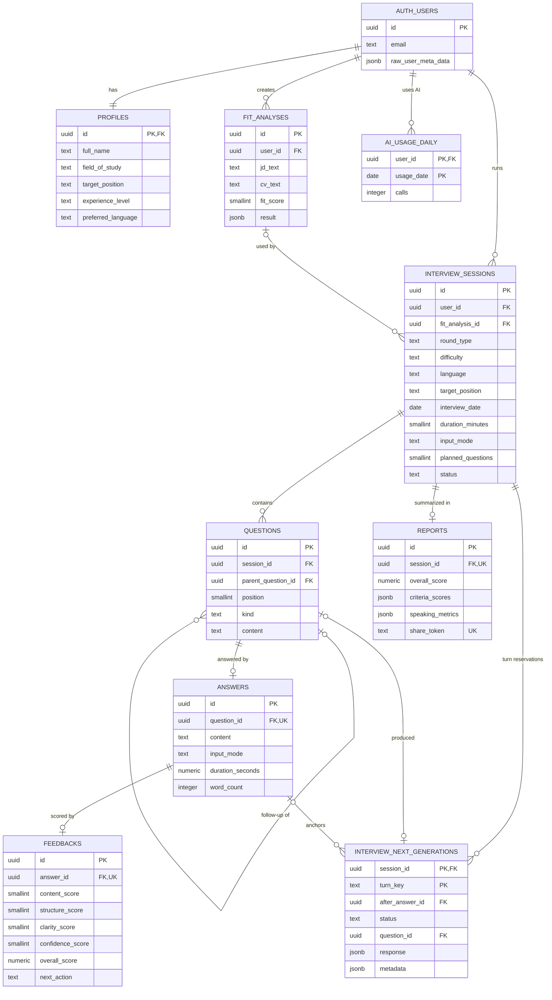

# InterviewBuddy – Database Design (v1.1)

Author: Nguyen Tran Trung Nhan · Sprint 3, week 5; extended with Week 7 Settings · Status: **local schema reference; verify all five migrations on staging**

Database: Supabase (PostgreSQL 17). Migrations, applied in order:

1. [`20261021000000_initial_schema.sql`](../../src/supabase/migrations/20261021000000_initial_schema.sql) – the 7 tables and RLS.
2. [`20261030000000_interview_session_settings.sql`](../../src/supabase/migrations/20261030000000_interview_session_settings.sql) – Interview Setup fields (UC-05) and the ownership check for linked analyses.
3. [`20261103000000_interview_next.sql`](../../src/supabase/migrations/20261103000000_interview_next.sql) – Hưng, SCRUM-92: per-turn reservations for `/api/interview/next` (`interview_next_generations`, `claim_` / `finish_` / `release_interview_next()`).
4. [`20261105000000_session_resume_ai_limit.sql`](../../src/supabase/migrations/20261105000000_session_resume_ai_limit.sql) – Nhân, SCRUM-80/81: `save_interview_answer()`, daily AI limit (`ai_usage_daily`, `consume_ai_call()`).
5. [`20261107000000_settings_data.sql`](../../src/supabase/migrations/20261107000000_settings_data.sql) – atomic own-data purge and a guarded answer persistence bridge; adds no tables.

Change the schema only with a new migration file, never by hand in the dashboard.

## 1. Entity–relationship diagram

## 2. Tables

**Users** are not a separate table: Supabase Auth stores them in `auth.users`. `profiles` holds our own user data and is created automatically by a trigger when someone signs up.

| Table | Feature | Key columns | Relationships |
| --- | --- | --- | --- |
| `profiles` | Sign-up, login and profile | `id` = `auth.users.id`; field of study, target position, experience level, preferred language (`vi`/`en`) | 1–1 with `auth.users`; deleted with the user |
| `fit_analyses` | JD and CV fit analysis | `jd_text` (≤ 3000 chars), `cv_text`, `fit_score` (0–100), `result` (full `/api/analyze-fit` JSON) | many per user |
| `interview_sessions` | Interview setup, chat interview, history | `round_type` (`hr`/`technical`/`behavioral`), `difficulty`, `language`, `target_position` (1–120 chars), `interview_date` (optional), `duration_minutes` (15/30/45), `input_mode` (`text`/`voice`), `planned_questions` (1–20, derived from the duration), `status` (`in_progress`/`completed`/`abandoned`), JD/CV snapshot | many per user; optional link to a fit analysis (set to null if it is deleted) |
| `questions` | Chat interview, targeted practice | `position` (unique per session), `kind` (`main`/`follow_up`/`practice`), `parent_question_id` for follow-ups | many per session |
| `answers` | Chat interview, voice answers | `content`, `input_mode` (`text`/`voice`), `duration_seconds`, `word_count` | at most one per question |
| `feedbacks` | Per-answer scoring and feedback | 4 rubric scores 0–10 (content, STAR structure, clarity, confidence), `overall_score`, explanation, strengths, improvements, sample answer, `next_action` (`follow_up`/`next_topic`/`end`) | at most one per answer |
| `reports` | Post-interview report, sharing | `overall_score`, `criteria_scores`, `speaking_metrics`, strengths, improvements, `share_token` | at most one per session |
| `interview_next_generations` | Chat interview (Hưng) | one row per turn (`turn_key` = previous answer id or `opening`): `status` (`generating`/`completed`/`failed`), lease `token` + `expires_at`, saved `response`, AI `decision` and `metadata` | many per session; makes a repeated request return the same question |
| `ai_usage_daily` | Daily AI limit | `usage_date` (Vietnam time), `calls` | one row per user per day; kept when the user deletes CV and history |

Deleting a user deletes all of their data (`on delete cascade`). Deleting a session deletes its questions, answers, feedback and report.

Not in this migration (added in later sprints when the features are built): bookmarks (history and progress tracking), practice plans (practice-plan agent).

## 3. Row Level Security (RLS)

RLS is enabled on **every** table. Without a matching policy, a request with the anon key sees nothing.

| Table | Who can read / write | How it is checked |
| --- | --- | --- |
| `profiles` | Owner: read, update | `id = auth.uid()` |
| `fit_analyses` | Owner: all operations | `user_id = auth.uid()` (`user_id` defaults to `auth.uid()`) |
| `interview_sessions` | Owner: all operations; a linked analysis must also be the owner's | `user_id = auth.uid()` and `owns_fit_analysis(fit_analysis_id)` |
| `questions`, `reports` | Owner of the session | `owns_session(session_id)` |
| `answers` | Owner of the question's session | `owns_question(question_id)` |
| `feedbacks` | Owner of the answer's session | `owns_answer(answer_id)` |
| `interview_next_generations` | Owner of the session: **read only** (selected columns). Written only by the three definer functions, which check `auth.uid()` | `owns_session(session_id)` |
| `ai_usage_daily` | Owner: **read only**. Only `consume_ai_call()` adds to it, so the limit cannot be reset from the browser | `user_id = auth.uid()` |

Functions called by the API (all `set search_path = ''`):

| Function | Runs as | Purpose |
| --- | --- | --- |
| `save_interview_answer(session, question, content, input_mode, duration)` | caller (RLS applies) | Save the answer to the last question; lock the session row; return the stored answer if it already exists |
| `claim_` / `finish_` / `release_interview_next(...)` | definer, checks `auth.uid()` | Reserve a turn, save the generated question, or release a failed turn |
| `consume_ai_call(limit)` | definer, only the caller's row | Count one Gemini call if today's count is below the limit |

- Shared reports are **not** readable through RLS. A server route finds the report by `share_token` with the service_role client and shows a read-only page. Setting `share_token` back to null revokes the link.
- The service_role key bypasses RLS, so it is used only on the server (`lib/supabase/admin.ts`).

## 4. Verification

The migration was run on a local PostgreSQL (PGlite) with stand-ins for `auth.users` and `auth.uid()`. Results:

| Check | Result |
| --- | --- |
| Both migrations run without errors | Pass |
| New setup fields: defaults (30 min, text), invalid duration / answer mode / empty position rejected | Pass |
| B cannot link a session to A's analysis, on insert or update | Pass (blocked by RLS) |
| Sign-up creates a profile with the name from email or Google metadata | Pass |
| User A sees only A's rows in all 7 tables; user B sees none of them | Pass |
| B cannot add questions or answers to A's session, create a session for A, or move a session to A | Pass (blocked by RLS) |
| B's update / delete on A's rows affects 0 rows | Pass |
| Scores outside 0–10, JD over 3000 characters, duplicate question position | Pass (rejected by constraints) |
| Deleting a user removes all of their data | Pass |
| Week 5 (`tests/session-persistence-db.test.mjs`, all four migrations): answer saved once and replayed; old question → `STALE_TURN`; ended session → `SESSION_CLOSED` | Pass |
| B cannot read A's sessions, questions, answers or generations; cannot answer, claim, finish or release A's turns; cannot write generations directly | Pass |
| Daily limit stops at the limit; each user has a separate count; users cannot insert, update or delete `ai_usage_daily`; signed-out callers cannot run the new functions | Pass |
| Deleting own sessions and analyses (Settings) removes questions and generations, keeps the AI count and other users' data | Pass |

Apply only missing, reviewed migrations on the intended Supabase environment. Verify RLS on every table, including `interview_next_generations` and `ai_usage_daily`; a local migration file is not evidence of cloud installation.

## 5. Week 7 additions (SCRUM-85/88)

`interview_next_generations` is internal state keyed by `(session_id,turn_key)`.
Its session and answer links cascade on deletion; question_id becomes null when its question is deleted.
Authenticated users have only limited column reads for their own sessions; writes use the guarded next-question RPCs.
Do not expose lease tokens or raw provider metadata in the browser.

`delete_own_practice_data()` has no user-id parameter. It requires auth.uid(), serializes repeated purges on the profile row, deletes only that user's sessions and analyses atomically, and returns row counts. Session children (questions, answers, feedbacks, reports, generation records) cascade. CV/JD snapshots are deleted with sessions. The profile, preferred language and auth account remain.

`save_own_interview_answer(session,question,content)` locks the owned session, accepts only its latest question while in progress, saves a text answer, and returns an existing answer only for an identical retry. Anonymous and foreign access is rejected. Both new security-definer functions use an empty search path and have execution revoked from public/anon, granted only to authenticated.

The integrated `/interview/[id]` route keeps Khang/Hưng's streaming Chat in `components/interview-chat`. It saves answers through the persistence API and `save_interview_answer()` from migration 20261105. The Week 7 `save_own_interview_answer()` bridge remains available for the original minimal Chat component, which is not mounted by that route. Purging practice data keeps `ai_usage_daily`, so deletion does not reset the daily AI budget.

The verification table above describes earlier migration checks. Week 7 local test results and hosted checks are recorded separately in `docs/testing/WEEK7_ACCEPTANCE.md`; no hosted migration application is claimed here.
