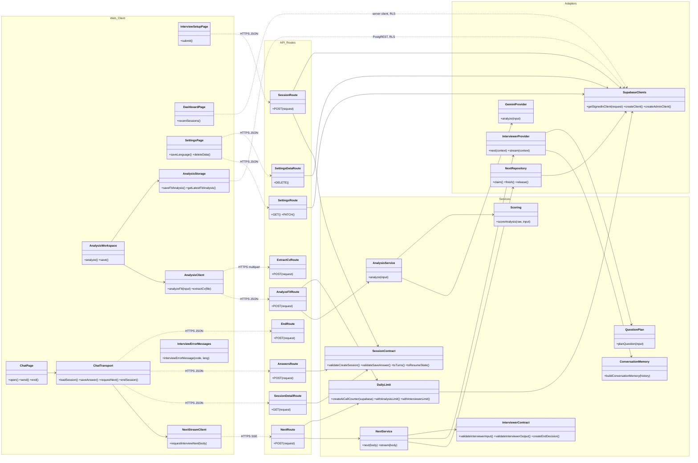
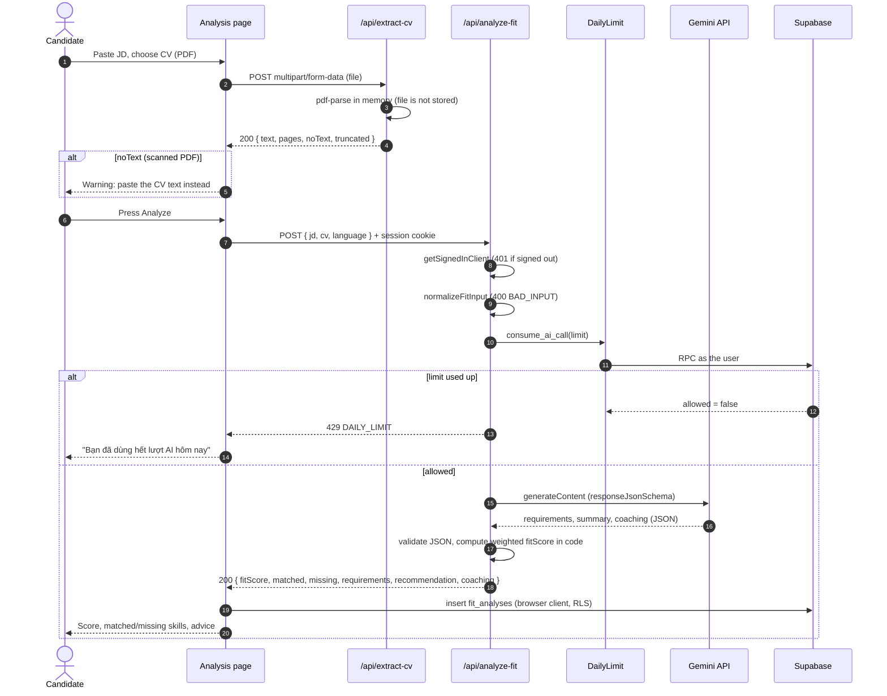
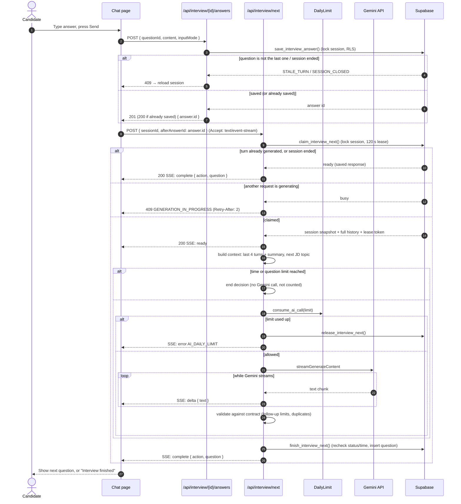
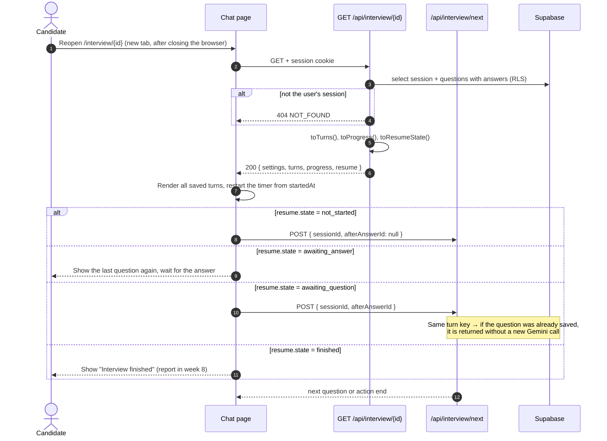
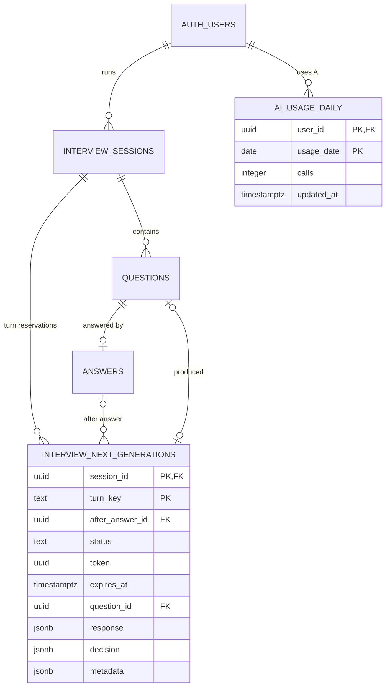

# InterviewBuddy – Detailed Design (v1.1)

Author: Nguyen Tran Trung Nhan · Jira: SCRUM-83, SCRUM-111 · Sprint 4, week 6 · Status: **matches `main` @ `0668228` (Build 1 candidate) on 13/11/2026**

This document is the detailed design for Build 1. It extends the [architecture overview](architecture.md) (components and connectors) and the [database design](database-design.md) (ERD and RLS).

| Section | Content |
| --- | --- |
| 1 | Component / class diagram of the main modules |
| 2 | Sequence diagrams: analyze CV/JD, one interview turn, resume a session |
| 3 | API table (every endpoint: input, output, errors) |
| 4 | ERD and database changes in weeks 5–6 |

## Version history

| Version | Date | Author | Change |
| --- | --- | --- | --- |
| 1.0 | 05/11/2026 | Nhân | First version for PA3 |
| 1.1 | 13/11/2026 | Nhân | Matches the built Build 1: Setup, Dashboard and Settings pages, streaming `/next` (SSE), Settings API, chat transport, settings migration (SCRUM-111) |
| 1.2 | 19/11/2026 | Nhân | API table: report endpoint (SCRUM-186, Build 2) |

## 1. Component / class diagram

Every server endpoint follows the same layers: **route handler** (HTTP, sign-in) → **service** (rules, validation) → **repository or adapter** (Supabase, Gemini). Services receive their dependencies as parameters, so the tests replace Supabase and Gemini with fakes or an in-memory PostgreSQL.

| Module | File(s) | Responsibility | Owner |
| --- | --- | --- | --- |
| AnalysisClient, AnalysisStorage | `lib/analysis/client.ts`, `storage.ts` | Call the analysis API; save/read fit analyses with RLS | Khang |
| InterviewErrorMessages | `lib/interview/error-messages.mjs` | Vietnamese/English message for every interview error code | Nhân |
| InterviewSetupPage | `app/(workspace)/interview/new/page.tsx` | Validate the form with `validateCreateSession`, call `POST /api/interview`, open `/interview/{id}` | Tài |
| DashboardPage | `app/(workspace)/dashboard/page.tsx` | Server Component: total and five latest sessions of the user (server Supabase client, RLS) | Tài |
| SettingsPage, Settings routes | `app/(workspace)/settings/page.tsx`, `app/api/settings/**`, `lib/settings/contract.mjs` | Preferred language; delete CV and history after typing `DELETE` | Tài |
| ChatPage, ChatTransport | `components/interview-chat/*`, `lib/interview-chat/transport.mjs` | Chat screen; load/resume, save answer, request next question, end | Khang |
| NextStreamClient | `lib/interview/next-stream-client.mjs`, `stream-protocol.mjs` | Read the SSE stream of `/next` in the browser; 35 s deadline | Hưng |
| Route handlers | `app/api/**/route.*` | Parse HTTP, check sign-in, map errors to status codes | owner of each endpoint |
| SessionContract | `lib/interview/session-contract.mjs` | Validate setup and answers; map DB rows ↔ API; compute resume state | Nhân |
| AnalysisService, Scoring | `lib/analysis/service.mjs`, `scoring.mjs` | Validate input, call Gemini, compute the weighted fit score in code | Hưng |
| NextService, InterviewerContract | `lib/interview/next-service.mjs`, `interviewer-contract.mjs` | Decide follow-up / next topic / end; validate the AI JSON; stream the question text | Hưng |
| ConversationMemory, QuestionPlan | `conversation-memory.mjs`, `question-plan.mjs` | Last four turns + summary; pick the next JD topic and CV evidence | Hưng |
| DailyLimit | `lib/ai/daily-limit.mjs`, `signed-in-analysis-route.mjs` | Count each Gemini call per user per day; block when the limit is reached | Nhân |
| GeminiProvider, InterviewerProvider | `lib/analysis/gemini.mjs`, `lib/interview/interviewer-provider.mjs` | The only code that holds `GEMINI_API_KEY`; timeout and error mapping | Hưng |
| NextRepository | `lib/interview/next-repository.mjs` | Call the claim / finish / release SQL functions | Hưng |
| SupabaseClients | `lib/supabase/*`, `lib/interview/http.ts` | Signed-in client from cookie or Bearer token; service-role client | Nhân |

## 2. Sequence diagrams

### 2.1 Analyze CV against JD (UC-03, UC-04)

### 2.2 One interview turn (UC-06)

`/next` answers with Server-Sent Events when the request has `Accept: text/event-stream` (the Chat page always sends it); otherwise it returns the same final result as plain JSON. Sign-in, input and claim errors come back as a normal HTTP error before the stream starts. Errors after `ready` (Gemini, validation, daily limit) arrive as an `error` event `{ error: { code, message } }` on an HTTP 200 stream, and the reservation is released. The browser stops waiting after 35 s.

### 2.3 Resume an unfinished session (UC-06, non-functional requirement "no lost session")

## 3. API table

All endpoints return JSON with `Cache-Control: no-store` (`/next` may stream SSE instead). Errors: `{ "error": { "code", "message", "fields" | "details"? } }`; the Settings routes (#11–13) return only `{ "error": { "message" } }`. "Sign-in" means the Supabase session cookie or `Authorization: Bearer <access_token>`.

| # | Method & path | Owner | Sign-in | Input | Output (success) | Errors | Contract |
| --- | --- | --- | --- | --- | --- | --- | --- |
| 1 | `GET /auth/callback?code=` | Tài | – | OAuth code from Google | 302 → `/dashboard` (session cookie set) | 302 → `/login?error=auth_callback` | – |
| 2 | `GET /api/health` (`?ai=1`) | Nhân | optional | – | 200 `{ supabase, gemini }` check results | 503 if a check fails | – |
| 3 | `POST /api/extract-cv` | Khang | – | multipart `file` (PDF ≤ 5 MB) | 200 `{ text, pages, noText, truncated }` | 400 `BAD_FILE` | – |
| 4 | `POST /api/analyze-fit` | Hưng / Khang | **yes** | `{ jd (30–3000), cv, language: vi\|en }` | 200 `{ fitScore, matched[], missing[], requirements[], recommendation, coaching }` | 400 `BAD_INPUT`, 401 `UNAUTHORIZED`, 429 `DAILY_LIMIT` / `RATE_LIMIT`, 502 `INVALID_OUTPUT`, 500/503/504 `SERVER_ERROR` | [CV_JD_ANALYSIS_API_v1](../api/CV_JD_ANALYSIS_API_v1.md), [KHANG_ANALYZE_FIT_COMPAT](../api/KHANG_ANALYZE_FIT_COMPAT.md) |
| 5 | `POST /api/analyze` | Hưng | **yes** | `{ cvText, jdText, language }` | 200 `{ analysisId, fitScore, matchedSkills, missingSkills, summary, coaching, requirements, scoreBreakdown, meta }` | 400 `VALIDATION_ERROR` / `INVALID_JSON`, 401, 403 `ORIGIN_NOT_ALLOWED`, 413, 415, 422 `NO_JOB_REQUIREMENTS` / `AI_CONTENT_BLOCKED`, 429 `AI_DAILY_LIMIT` / `AI_RATE_LIMITED`, 502, 503, 504 | [CV_JD_ANALYSIS_API_v1](../api/CV_JD_ANALYSIS_API_v1.md) |
| 6 | `POST /api/interview` | Nhân | yes | `{ type, difficulty, language, targetPosition, interviewDate?, durationMinutes: 15\|30\|45, inputMode, fitAnalysisId? }` | 201 `{ sessionId, fitAnalysisId }` | 400 `BAD_INPUT` (+ `fields`), 401, 500 | [Session API v1](../api/INTERVIEW_SESSION_API_v1.md) |
| 7 | `GET /api/interview/{id}` | Nhân | yes | – | 200 `{ id, status, startedAt, endedAt, settings, analysis, turns[], progress, resume }` | 401, 404 `NOT_FOUND` (also another user's session), 500 | [Session API v1 §3](../api/INTERVIEW_SESSION_API_v1.md), [Persistence API §3](../api/INTERVIEW_PERSISTENCE_API_v1.md) |
| 8 | `POST /api/interview/{id}/answers` | Nhân | yes | `{ questionId, content (1–12000), inputMode?, durationSeconds? }` | 201 / 200 `{ answer: { id, questionId, createdAt }, alreadySaved }` | 400 `BAD_INPUT`, 401, 404, 409 `STALE_TURN` / `SESSION_CLOSED`, 500 | [Persistence API §4](../api/INTERVIEW_PERSISTENCE_API_v1.md) |
| 9 | `POST /api/interview/{id}/end` | Nhân | yes | – | 200 `{ id, status, endedAt }` | 401, 404, 500 | [Persistence API §5](../api/INTERVIEW_PERSISTENCE_API_v1.md) |
| 10 | `POST /api/interview/next` | Hưng | yes | `{ sessionId, afterAnswerId: uuid\|null }` (≤ 2 KB); `Accept: text/event-stream` to stream | JSON: 200 `{ sessionId, action: next_topic\|follow_up\|end, question: { id, content, topic, kind, position } \| null }`. SSE: `ready` → `delta { text }`… → `complete` (same object) or `error` | 400, 401, 404, 408, 409 `STALE_TURN` / `GENERATION_IN_PROGRESS` / `LEASE_LOST` / `SESSION_CONTEXT_INVALID`, 422, 429 `AI_DAILY_LIMIT` / `AI_RATE_LIMITED`, 502, 503, 504, 500 (after `ready`: as an `error` event) | [Interview Next API v1](../api/INTERVIEW_NEXT_API_v1.md) |
| 11 | `GET /api/settings` | Tài | yes | – | 200 `{ preferredLanguage: vi\|en }` | 401, 404 (no profile), 500, 503 | – |
| 12 | `PATCH /api/settings` | Tài | yes, same origin | `{ preferredLanguage: vi\|en }` (only this field) | 200 `{ preferredLanguage }` | 400, 401, 403 (cross-site), 404, 500, 503 | – |
| 13 | `DELETE /api/settings/data` | Tài | yes, same origin | `{ confirmation: "DELETE" }` | 200 `{ sessionsDeleted, analysesDeleted }`: sessions (with questions, answers, feedback, reports, generations) and saved analyses are deleted; account, profile and AI count are kept | 400, 401, 403, 500, 503 (function missing) | – |
| 14 | `GET /api/report/{sessionId}` (`?retry=summary`) | Nhân | yes | – | 200 `{ sessionId, generatedAt, settings, overview (overallScore, trend…), criteria, structureApplies, speaking, summary, timeline[] }` | 401, 404 `NOT_FOUND`, 409 `SESSION_NOT_COMPLETED` / `NO_SCORED_ANSWERS`, 500 | [Report API v1](../api/REPORT_API_v1.md) |
| – | `POST /api/evaluate-answer` | Hưng | yes | (week 7) | per-answer scores and feedback | – | to be added |

Data the browser reads or writes **directly** through Supabase (RLS checks the owner):

| Table | Operation | Page |
| --- | --- | --- |
| `profiles` | select, update own row | Profile (Tài) |
| `fit_analyses` | insert, select latest | Analysis (Khang) |
| `interview_sessions` | count and five latest (server Supabase client in a Server Component) | Dashboard (Tài) |
| `ai_usage_daily` | select own rows | optional "AI calls left today" (not used by a page yet) |

Settings no longer deletes rows from the browser: it calls `DELETE /api/settings/data`, which runs `delete_own_practice_data()` in one transaction.

## 4. ERD and database changes in weeks 5–6

Two tables were added in week 5; week 6 added functions only. No existing column changed. The full ERD and RLS table are in [database-design.md](database-design.md).

| Migration | Owner | Adds |
| --- | --- | --- |
| `20261103000000_interview_next.sql` | Hưng (SCRUM-92) | `interview_next_generations`; `claim_`, `finish_`, `release_interview_next()` |
| `20261105000000_session_resume_ai_limit.sql` | Nhân (SCRUM-80, -81) | `save_interview_answer()`; `ai_usage_daily`; `consume_ai_call()` |
| `20261107000000_settings_data.sql` | Tài / Hưng (SCRUM-88, SCRUM-94) | `delete_own_practice_data()` (Settings); `save_own_interview_answer()` (not called by the current Chat page, which uses `POST /api/interview/{id}/answers`) |
