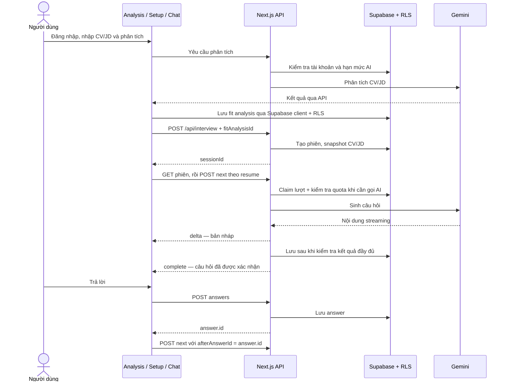

# InterviewBuddy — Hướng dẫn kết nối các phần của nhóm

Ngày đối chiếu mã nguồn: **07/11/2026**. Phạm vi: đăng nhập → phân tích CV/JD → thiết lập phiên → Chat với AI → lưu câu trả lời → tiếp tục phiên → kết thúc.

**Cập nhật ghép Setup:** đã kết hợp nhánh Tài `c7d5ca7` với bản SCRUM-94 `de1b323`, giữ Chat streaming và nhận Setup/Dashboard/Settings mới. Bản ghép đạt 243 test cục bộ, lint, typecheck và 5 nhóm kiểm tra giao diện; chưa chạy lại AI/persistence thật hoặc triển khai migration Settings lên cloud. Xem [báo cáo xử lý xung đột](../test/SCRUM-94_SETUP_MERGE_20261107_VI.md).

**Bổ sung khi xuất bản code:** nhánh `feat/scrum-94-chat-streaming-hung` ghép các nhánh persistence của Nhân (`b509af5`), Chat của Khang (`ce7d687`) và hướng dẫn (`026568c`), sau đó thêm triển khai streaming và các sửa tích hợp. Những dòng “chưa commit/push” bên dưới ghi lại snapshot trước đợt xuất bản. Xem [báo cáo xuất bản và kiểm tra](../test/SCRUM-94_PUBLICATION_20261106_VI.md); trạng thái nghiệm thu Chat/Supabase thật vẫn chưa đạt xác nhận.

Tài liệu này hướng dẫn tích hợp và bàn giao, không xác nhận nhóm đã nghiệm thu. Các tên nhánh/commit bên dưới là snapshot đã kiểm tra cục bộ; cần fetch và kiểm tra lại trước khi ghép code.

## 1. Nhóm cần làm gì trước?

1. **Nhân/người quản lý Supabase:** bàn giao URL + anon key của môi trường test, xác nhận migration và tài khoản test đã xác nhận email.
2. **Người phụ trách ghép code:** tích hợp persistence, Chat và streaming; giữ các sửa lỗi giao tiếp/quota trong bản ghép. Chỉ lấy từng nhánh riêng lẻ thì chưa đủ.
3. **Mỗi thành viên:** cấu hình `src/.env.local` trên máy mình. Hưng và Khang chạy toàn luồng Chat thật sau khi cấu hình xong.

### Trạng thái hiện tại

| Hạng mục | Trạng thái đã kiểm tra |
| --- | --- |
| Bản ghép persistence + Chat + streaming | Nhánh `feat/scrum-94-chat-streaming-hung`, thư mục `publish-scrum94`; nền `de1b323` đã xuất bản qua PR #22, phần ghép Setup ngày 07/11 đang được chốt local. |
| SCRUM-94 riêng | Streaming/policy đã nằm trong nhánh tích hợp; bản cũ ở thư mục `main` được giữ để bảo toàn thay đổi local. |
| Setup/Chat/Settings + HTTP nghiệp vụ giả lập | Bản ghép 07/11 đạt 5 nhóm kiểm tra trên trang có bảo vệ: đăng nhập/profile thật, HTTP phiên/Settings và SSE giả lập; không gọi Gemini hay ghi/xóa practice data cloud. |
| Kiểm thử offline bản ghép | 243/243 đạt; không phải kiểm thử Supabase cloud. |
| Chat + Supabase dùng chung + Gemini thật | Đã chạy trên `444fc08` ngày 06/11: API 19/19 đạt; 19/20 lượt sinh mới hợp lệ, 16/20 nhanh và hợp lệ. Chưa đạt toàn bộ SCRUM-94 và chưa chạy lại trên bản ghép Setup. Xem [báo cáo thật](../test/SCRUM-94_REAL_CHAT_SUPABASE_20261106_VI.md). |
| Trang thiết lập `/interview/new` | Đã nối POST tạo phiên và mở Chat streaming trong bản ghép local; còn cần xác nhận lại luồng dùng API/Supabase thật sau tích hợp. |

Hướng dẫn dưới đây phân biệt code đã ghép với các bước kiểm thử cloud và bàn giao còn cần xác nhận.

## 2. Trách nhiệm và nội dung bàn giao

| Phần | Người phụ trách theo tài liệu/mã nguồn hiện có | Bàn giao cho nhóm | Điều kiện kiểm tra |
| --- | --- | --- | --- |
| Supabase, persistence, hạn mức AI — SCRUM-79 | Nhân | URL/anon key qua kênh phù hợp; trạng thái 4 migration persistence và migration Settings bổ sung; tài khoản test; API tạo/tải phiên, lưu answer, kết thúc; RPC quota | Lưu/tải lại được; tài khoản khác không truy cập dữ liệu; quota chặn trước khi gọi AI. |
| AI interview/streaming — SCRUM-92/93/94 | Hưng | API `/api/interview/next`; quy tắc follow-up/next-topic; SSE consumer; timeout, hủy, số đo và test | Chỉ xác nhận câu hỏi sau kiểm tra và lưu DB; draft lỗi được xóa; không gọi AI tự động thêm khi thử lại. |
| Chat — SCRUM-95 | Khang | `/interview/[id]`; render lịch sử; gửi answer qua API; preview streaming; thông báo vi/en và resume | Dùng đúng answer ID; khóa gửi khi câu hỏi chưa hoàn tất; reload không mất các lượt đã lưu. |
| Đăng nhập và UI dùng chung | Tài theo README của nhóm | Luồng đăng nhập, session cookie, bảo vệ trang | Các API nhận đúng tài khoản đã đăng nhập; phiên hết hạn có đường đăng nhập lại. |
| Nối form thiết lập | Người phụ trách form, phối hợp Nhân/Khang; cần nhóm chốt người nhận | Ánh xạ form sang `POST /api/interview`, xử lý lỗi, chuyển đến ID thật | Không dùng ID mẫu; không chuyển trang nếu tạo phiên thất bại. |
| CV/JD analysis và chọn kết quả đã lưu | Khang phối hợp Hưng/Nhân | Phân tích + trạng thái lưu kết quả; ID của `fit_analyses` để liên kết phiên | Kết quả đã lưu thành công và thuộc chính tài khoản đang tạo phiên. |

**Điền `.env.local` là việc cấu hình trên từng máy.** Hưng không cần xây lại database của Nhân. Người giữ project Supabase chịu trách nhiệm cung cấp cấu hình và xác nhận database dùng chung đã sẵn sàng.

## 3. Luồng dữ liệu giữa các phần



### Ba ID phải phân biệt

| ID | Dùng ở đâu | Nguồn lấy |
| --- | --- | --- |
| `fitAnalysisId` | Liên kết kết quả phân tích CV/JD khi tạo phiên | ID bản ghi `fit_analyses` sau khi lưu thành công. |
| `sessionId` | URL Chat và tất cả API của buổi phỏng vấn | Response của `POST /api/interview`. |
| `questionId` / `answer.id` | Lưu câu trả lời / yêu cầu câu tiếp theo | Câu hỏi đã complete / response lưu answer. Hai ID này không thay thế nhau. |

Trong implementation hiện tại, phần analysis lưu `fit_analyses` bằng Supabase client của người dùng trong `src/lib/analysis/storage.ts`. **Question/answer của Chat phải đi qua API**; không sao chép cách ghi trực tiếp của analysis sang Chat.

Khi tạo phiên, backend snapshot `cv_text`/`jd_text` từ analysis vào session. Các lần gọi `next` chỉ gửi ID; frontend không gửi lại CV/JD, lịch sử hoặc số câu để tự quyết định trạng thái phỏng vấn.

## 4. Lấy và ghép đúng code

### 4.1. Các nguồn đã đối chiếu

| Nguồn | Commit snapshot | Nội dung |
| --- | --- | --- |
| `origin/main` | `366cbd3` | Nền chung; đã có các thay đổi SCRUM-92/93 được merge trước đó. |
| `origin/feat/scrum-79-session-persistence` | `b509af5` | Persistence, resume, quota và API contract cập nhật. |
| `origin/feat/interview-chat-khang` | `ce7d687` | Giao diện Chat của Khang. |
| `main` local, `feat/scrum-94-interview-streaming` | HEAD `baa2f8e` + thay đổi chưa commit | Streaming; HEAD không bao gồm các thay đổi đang nằm trong working tree. |
| `scrum94-chat-supabase` local, `test/scrum94-chat-supabase-20261106` | HEAD `b509af5` + thay đổi chưa commit | Bản ghép cả ba phần và các sửa lỗi tích hợp. |

**Không có lệnh pull nào lấy được thay đổi chưa push.** Nhóm cần review, commit và đưa bản tích hợp lên nhánh/PR trước khi các máy khác có thể tải bản đó từ GitHub.

### 4.2. Thứ tự tích hợp đề nghị cho người ghép code

1. Kiểm tra `git status --short`, commit/chuyển riêng công việc đang làm trước khi đổi nhánh. Với worktree đang có nhiều thay đổi, dùng checkout/worktree sạch để ghép.
2. `git fetch origin`, đối chiếu HEAD và các PR đã merge để tránh ghép lại phần đã có.
3. Lấy nền `origin/main`, ghép persistence của Nhân, sau đó Chat của Khang.
4. Ghép thay đổi SCRUM-94 **đã được xuất bản/review** cùng adapter Chat và sửa quota streaming. Hiện các thay đổi này vẫn local.
5. Chạy các bước kiểm tra tại mục 9, tạo PR theo quy ước repository; người phụ trách review/merge của nhóm xử lý PR.

Tại máy hiện tại, có thể xem bản ghép sẵn ở `D:\BackUp\HCMUS_Semester_7\introSE\project\scrum94-chat-supabase`. Không cần merge lại các nhánh vào thư mục này chỉ để đọc hoặc chạy kiểm tra.

### 4.3. Những file phải giữ khi giải quyết xung đột

| File/nhóm file tính từ root repo | Phần cần giữ |
| --- | --- |
| `src/app/api/interview/next/route.ts` | Cả SSE handler của Hưng lẫn `withInterviewerLimit(..., createAiCallCounter(auth.supabase))` của Nhân. |
| `src/lib/ai/daily-limit.mjs` | Giới hạn áp dụng cho cả `next()` và `stream()`. Chỉ bọc `next()` sẽ bỏ sót luồng streaming. |
| `src/lib/interview/{interviewer-provider,next-service,next-http}.mjs` và `.d.mts` | Provider stream, kiểm tra đầy đủ, lưu trước complete, hợp đồng type tương ứng. |
| `src/lib/interview/{next-stream-client,stream-protocol,timing-trace}.mjs` và các `.d.mts` hiện có | Đọc SSE, deadline/hủy, đo thời gian; không thay bằng cách đọc toàn bộ response rồi mới hiện chữ. |
| `src/lib/interview-chat/{client.ts,transport.mjs,transport.d.mts}` | Tải/lưu/kết thúc qua API và chuyển tiếp callback streaming. |
| `src/components/interview-chat/` và `src/lib/interview-chat/{types.ts,text.ts}` | Draft, khóa input, hủy, 5/10 giây, lỗi và trạng thái vi/en. |
| `src/app/(workspace)/interview/[id]/page.tsx` | Trang Chat thật và kiểm tra quyền truy cập hiện có. |
| `src/supabase/migrations/` | Đủ migration theo thứ tự ở mục 6; không sửa migration cũ đã áp dụng để giải quyết xung đột. |

Không ghi đè toàn bộ route bằng phiên bản từ một nhánh. Bản tích hợp đã sửa trường hợp quota chỉ bọc `next()` trong khi Chat dùng `stream()` và đã chuyển Chat sang API persistence.

## 5. Cấu hình để chạy trên máy mỗi người

### 5.1. Đúng thư mục

Repository chứa ứng dụng trong **`src/`**. Mọi lệnh npm bên dưới chạy tại thư mục này; file cấu hình là **`src/.env.local`**, không phải `.env.local` ở root repo.

Ví dụ với bản tích hợp ở máy hiện tại:

```powershell
Set-Location 'D:\BackUp\HCMUS_Semester_7\introSE\project\scrum94-chat-supabase\src'
if (-not (Test-Path -LiteralPath '.env.local')) {
    Copy-Item -LiteralPath '.env.example' -Destination '.env.local'
}
```

Trên checkout riêng của từng thành viên, dùng `npm ci` để cài đúng lockfile. **Bản tích hợp trên máy hiện tại đang dùng junction `node_modules` của `main`; không chạy `npm ci` trong bản này**, vì có thể tác động dependency đang dùng chung. Runner UI hiện có tự cấu hình additional root cho junction.

### 5.2. Các giá trị cần điền

| Biến trong `src/.env.local` | Ai cung cấp / ý nghĩa |
| --- | --- |
| `NEXT_PUBLIC_SUPABASE_URL` | Nhân/admin cung cấp URL đúng môi trường test. |
| `NEXT_PUBLIC_SUPABASE_ANON_KEY` | Nhân/admin cung cấp anon key cùng project với URL. Code hiện đọc đúng tên biến này. |
| `GEMINI_API_KEY` | Khóa Gemini của người được phép dùng; chỉ đọc ở server. |
| `GEMINI_MODEL` | Model của nhóm có quyền truy cập; giữ model nhóm đang kiểm tra, không tự đổi để ghép code. `.env.example` hiện đặt `gemini-3.5-flash-lite`. |
| `GEMINI_INTERVIEW_MODEL` | Tùy chọn; trống thì dùng `GEMINI_MODEL`. |
| `GEMINI_TIMEOUT_MS=30000` | Timeout upstream mặc định. |
| `AI_DAILY_LIMIT=100` | Số lượt AI mỗi người/ngày; thống nhất giá trị trên server test. |
| `NEXT_PUBLIC_INTERVIEW_MOCK=0` | Dùng Chat thật. Giá trị `1` chỉ dùng dữ liệu mẫu, không lưu DB/không gọi Gemini. |
| `INTERVIEW_TIMING_LOGS=1` | Tùy chọn bật số đo backend trong bản SCRUM-94; log thời gian không thay thế số đo UI. |

Luồng Chat thông thường không cần `SUPABASE_SERVICE_ROLE_KEY`, `GOOGLE_CLIENT_SECRET` hoặc mật khẩu admin. Service-role trong file mẫu dành cho công cụ quản trị có mục đích riêng; để trống khi chỉ chạy Chat. Không đặt khóa bí mật dưới tên `NEXT_PUBLIC_*`, không commit `.env.local` và không chụp ảnh giá trị khóa.

Sau khi đổi cấu hình, dừng và khởi động lại Next.js. Giữ cùng hostname lúc đăng nhập và dùng app, ví dụ `http://localhost:3000`, để tránh nhầm cookie giữa `localhost` và `127.0.0.1`.

Checkout độc lập sau khi cài dependency:

```powershell
npm run dev
```

Riêng worktree dùng junction trên máy hiện tại, chạy từ `scrum94-chat-supabase/src`:

```powershell
$env:INTERVIEW_LINKED_DEPENDENCY_ROOT = (Resolve-Path -LiteralPath '..\..\main\src').Path
npm run dev
```

Đây là cấu hình dependency local, không phải biến kết nối Supabase mà mọi thành viên phải có.

## 6. Chuẩn bị Supabase — Nhân/admin thực hiện

Xác nhận năm migration sau đã được áp dụng **đúng thứ tự** lên project test; migration Settings thứ 5 còn cần review/xác nhận cloud sau bản ghép này:

| Thứ tự | File trong `src/supabase/migrations/` | Chức năng |
| --- | --- | --- |
| 1 | `20261021000000_initial_schema.sql` | Schema nền và RLS. |
| 2 | `20261030000000_interview_session_settings.sql` | Thiết lập phiên/liên kết analysis. |
| 3 | `20261103000000_interview_next.sql` | Claim/finish/release cho lượt sinh câu hỏi. |
| 4 | `20261105000000_session_resume_ai_limit.sql` | Lưu answer, resume và hạn mức AI. |
| 5 | `20261107000000_settings_data.sql` | Xóa practice data của chính user và answer bridge tương thích; không reset AI usage. |

Các RPC cần có cho Chat streaming: `claim_interview_next`, `finish_interview_next`, `release_interview_next`, `save_interview_answer`, `consume_ai_call`. Migration Settings bổ sung `delete_own_practice_data` và `save_own_interview_answer`; route Chat chính vẫn dùng persistence API và `save_interview_answer`.

Mỗi thành viên không tự chạy lại toàn bộ migration vào DB chung. Nhân/admin đối chiếu lịch sử migration rồi dùng quy trình triển khai DB của nhóm; không reset DB hoặc tắt RLS để vượt lỗi kết nối.

Nhân/admin cũng xác nhận:

- URL và anon key thuộc cùng project; hai tài khoản test A/B đã xác nhận email.
- Đăng nhập bằng mật khẩu dùng được; nếu dùng Google OAuth thì redirect URL khớp địa chỉ app đang test.
- Tài khoản A có dữ liệu test riêng; tài khoản B dùng để kiểm tra ownership.
- Có thể lưu/tải lại session và kiểm tra quota dưới quyền người dùng, không dùng service-role cho lượt Chat.

**Trạng thái cloud hiện chưa được kiểm tra.** Danh sách trên là điều kiện bàn giao, không phải thông báo các migration đã chạy thành công.

## 7. Cách nối API giữa Setup, Chat và persistence

Các API dùng session cookie khi gọi cùng origin trong app, hoặc Bearer token của tài khoản test khi dùng công cụ API. Không gửi token vào tài liệu/báo cáo.

### 7.1. Tạo phiên từ form — đã nối trong bản ghép

File UI: `src/app/(workspace)/interview/new/page.tsx`.

Form gọi `POST /api/interview`, kiểm tra session ID rồi mở route sử dụng Chat streaming. Trong bản ghép hiện tại không cần thêm một Chat JSON khác hoặc tự tạo phiên bằng Console. Form vẫn yêu cầu ngày, trong khi contract API cho phép null.

Ánh xạ tên field hiện có trong form:

| Field của form | Field gửi API | Chuyển đổi |
| --- | --- | --- |
| `targetPosition` | `targetPosition` | Trim; 1–120 ký tự. |
| `roundType` | `type` | `hr`, `technical`, `behavioral`. |
| `difficulty` | `difficulty` | `easy`, `medium`, `hard`. |
| `language` | `language` | `vi`, `en`. |
| `interviewDate` | `interviewDate` | Chuỗi trống → `null`; còn lại `YYYY-MM-DD`, không trước hôm nay theo giờ Việt Nam. |
| `duration` | `durationMinutes` | `Number(form.duration)`; chỉ 15/30/45. |
| `answerMode` | `inputMode` | Contract nhận `text`/`voice`; trước mắt kiểm tra toàn luồng với `text`. Chat transport hiện gửi answer bằng text, chưa chứng minh đầy đủ voice. |
| Analysis đã lưu được chọn | `fitAnalysisId` | Xem ba cách dưới đây. |

Body hợp lệ của `POST /api/interview`:

```json
{
  "type": "technical",
  "difficulty": "medium",
  "language": "vi",
  "targetPosition": "Frontend Intern",
  "interviewDate": null,
  "durationMinutes": 30,
  "inputMode": "text",
  "fitAnalysisId": null
}
```

- `fitAnalysisId: null`: không liên kết analysis; phù hợp kiểm tra synthetic ban đầu.
- Không gửi field `fitAnalysisId`: backend tìm analysis mới nhất của tài khoản; không có thì tạo phiên không liên kết.
- Gửi UUID thật: liên kết chính analysis đó; báo lỗi nếu không tìm thấy trong dữ liệu tài khoản.

Không gửi `plannedQuestions`: backend tự gán 15/30/45 phút → 5/8/12 câu chính. Field không nằm trong contract bị từ chối.

Thành công: HTTP **201**, body `{ "sessionId": "<UUID thật>", "fitAnalysisId": null }`. Chỉ sau đó mới chuyển đến `/interview/<sessionId>`. Nếu lỗi, giữ người dùng ở form và hiển thị lỗi; khóa nút trong khi đang gửi để tránh tạo hai phiên.

**Chỉ dành cho checkout cũ còn nút Setup disabled:** đăng nhập trên app test, mở Developer Tools → Console tại cùng origin, chạy đoạn sau một lần. Không cần bước này với bản ghép 07/11. Đoạn này tạo một phiên test thật, không phải thay đổi code UI và chưa gọi Gemini:

```javascript
const response = await fetch('/api/interview', {
  method: 'POST',
  headers: { 'Content-Type': 'application/json' },
  body: JSON.stringify({
    type: 'technical', difficulty: 'medium', language: 'vi',
    targetPosition: 'Frontend Intern', interviewDate: null,
    durationMinutes: 30, inputMode: 'text', fitAnalysisId: null
  })
});
const body = await response.json();
if (!response.ok || !body.sessionId) throw new Error(body.error?.code ?? 'CREATE_FAILED');
console.log('Open Chat:', '/interview/' + body.sessionId);
```

Mở đường dẫn được in ra để bắt đầu Chat. Không dùng đoạn tạo phiên nhiều lần chỉ để tải lại cùng buổi phỏng vấn.

### 7.2. Tải phiên và quyết định tiếp tục

`GET /api/interview/{sessionId}` trả settings, `startedAt`, `endedAt`, `turns`, `progress` và `resume`.

| `resume.state` | Chat cần làm |
| --- | --- |
| `not_started` | Gọi `next` với `afterAnswerId: null`. |
| `awaiting_answer` | Hiện câu hỏi đã lưu, chờ người dùng; không sinh lại. |
| `awaiting_question` | Gọi `next` với `resume.afterAnswerId`. |
| `finished` | Hiện trạng thái kết thúc; khóa gửi câu trả lời. |

Không chỉ dựa vào biến React trong bộ nhớ. Reload phải dựng lại từ GET session. Khi gặp `STALE_TURN`/`LEASE_LOST`, tải lại GET và đối soát theo `resume`, không tự tạo anchor mới.

### 7.3. Sinh câu hỏi mở đầu/tiếp theo

`POST /api/interview/next`, body chỉ gồm:

```json
{ "sessionId": "<UUID phiên>", "afterAnswerId": null }
```

Sau khi đã lưu answer, thay `null` bằng **`answer.id` vừa nhận từ backend**. Không dùng `questionId`, số thứ tự câu hỏi hoặc ID tự tạo trên browser.

Header `Accept: text/event-stream` bật SSE; nếu không yêu cầu SSE thì endpoint giữ kiểu final JSON để tương thích. Kết quả hợp lệ gồm `sessionId`, `action`, `question`; `action` là `follow_up`, `next_topic` hoặc `end`. `question` là `null` khi kết thúc.

### 7.4. Lưu câu trả lời trước khi gọi câu tiếp theo

`POST /api/interview/{sessionId}/answers`:

```json
{
  "questionId": "<UUID câu hỏi đã complete>",
  "content": "Em sẽ hủy request cũ bằng AbortController trước khi gửi request mới.",
  "inputMode": "text",
  "durationSeconds": null
}
```

`content` dài 1–12000 ký tự sau trim; `durationSeconds` tùy chọn, 0–3600 hoặc `null`. Response **201** lần đầu hoặc **200** khi answer đã tồn tại:

```json
{
  "answer": { "id": "<UUID answer>", "questionId": "<UUID question>", "createdAt": "<timestamp>" },
  "alreadySaved": false
}
```

Chỉ sau response lưu thành công mới gọi `next`. Gửi lại cùng question trả answer đã lưu, không ghi đè nội dung cũ; sau lỗi mạng cần đối soát trước khi cho sửa/gửi một câu trả lời khác.

### 7.5. Kết thúc

`POST /api/interview/{sessionId}/end`, **không cần body**. Server trả `{id,status,endedAt}`. Dừng request đang chờ ở UI, khóa gửi và hiển thị kết thúc; backend kiểm tra lại trạng thái trước khi lưu câu hỏi đang sinh.

## 8. Nối streaming vào Chat đúng cách

Trong bản ghép, UI gọi `requestNext` qua `src/lib/interview-chat/client.ts`; adapter `transport.mjs` dùng consumer `src/lib/interview/next-stream-client.mjs`.

| Tín hiệu | UI được phép làm |
| --- | --- |
| `ready` | Hiện đang xử lý. Đây chưa phải chữ đầu của câu hỏi. |
| `delta` / `onPreview(text)` | Hiện nội dung nháp đang tích lũy; vẫn khóa ô trả lời. Callback đã trả toàn bộ preview, không nối lại lần nữa. |
| `complete` / promise resolve | Xác nhận câu hỏi đã kiểm tra và lưu; dùng ID thật từ response, mở ô trả lời nếu còn câu hỏi. |
| `error` / promise reject | Xóa nháp và hiện lỗi; không lưu draft thành câu hỏi hợp lệ. |
| `AbortController.abort()` | Hủy chờ, xóa nháp. Nếu kết quả lưu ở server chưa rõ, tải lại phiên để đối soát. |

`onStatus` có các trạng thái `generating`, `slow` sau 5 giây, `extended` sau 10 giây, `complete`, `cancelled`, `error`. Cảnh báo 5/10 giây không tự gọi thêm Gemini. Timeout upstream mặc định 30 giây; consumer browser có deadline toàn request mặc định 35 giây.

SSE có thể trả HTTP 200 rồi mới phát event `error`, vì vậy chỉ kiểm tra `response.ok` là chưa đủ. Dùng consumer sẵn có để kiểm tra event, schema và trường hợp stream bị ngắt.

Các quy tắc cần giữ:

- Một request sinh câu hỏi đang chạy tại một thời điểm; không gọi lại khi component render lại.
- Không tự retry tốn lượt AI. Nút thử lại giữ đúng `{sessionId, afterAnswerId}` và đối soát sau lỗi mạng/hủy.
- Không mở input khi mới có delta; không hiển thị JSON nội bộ, `reason`, thought hoặc prompt cho người dùng.
- Giữ quota cho cả JSON lẫn stream. Replay hoặc kết thúc không cần gọi AI không bị tính thành lượt sinh mới; lỗi thực sự sau khi gọi AI có thể đã tiêu thụ lượt.
- `onMetrics.firstDeltaMs` đo lúc nhận delta, không chứng minh chữ đã render. Khi đo nghiệm thu phải ghi thời điểm chữ thật xuất hiện trên UI. Replay/end có thể complete ngay và `firstDeltaMs: null`.

## 9. Cách kiểm tra sau khi kết nối

### 9.1. Kiểm tra trên máy, chưa chứng minh cloud

Tại `src/` của bản đã ghép:

```powershell
npm test
npx next typegen
npm run typecheck
npm run verify:secrets
```

Chạy ESLint cho các file thực sự thay đổi theo phạm vi PR. Các kết quả lịch sử 241/241 offline và 5 kịch bản UI giả lập không thay thế việc chạy lại trên commit mà nhóm sẽ review.

Runner `src/tests/browser/chat_stream_ui.py` cần Python có Playwright và Edge. Bản xuất bản code tự nhận dependency root khi `node_modules` là junction; checkout độc lập không cần có thư mục `main` bên cạnh. Chọn `--bundler turbopack` để kiểm tra cả CSS theo cấu hình Tailwind hiện có. Runner tạo route fixture tạm rồi dọn sau test; không dùng route này làm đường vào Chat sản phẩm.

### 9.2. Kiểm tra persistence trên Supabase thật, không gọi Gemini

Nhân chuẩn bị dữ liệu test và hai user `candidate.a@interviewbuddy.test` / `candidate.b@interviewbuddy.test`. Script `src/scripts/test-session-api.mjs` cần `SEED_USER_PASSWORD` đúng tài khoản seed và cấu hình Supabase; `API_BASE_URL` mặc định `http://localhost:3000`.

Sau khi app chạy và Nhân xác nhận dữ liệu test đã sẵn sàng:

```powershell
npm run test:session-api
```

Script tạo/xóa session test, chèn câu hỏi tổng hợp dưới quyền user và kiểm tra persistence/RLS/quota. Nó không gọi Gemini, không đo streaming Chat. Không tự chạy `npm run seed` vào DB nhóm: script seed cần quyền quản trị và có tác động dữ liệu; Nhân/admin quản lý bước này trên môi trường test.

### 9.3. Kiểm tra bằng tay trên Chat + Supabase + Gemini thật

| Bước | Thao tác | Kết quả cần ghi nhận |
| --- | --- | --- |
| 1 | Tắt mock, restart app, đăng nhập user A. | Vào trang được bảo vệ; request dùng session thật. |
| 2 | Phân tích CV/JD tổng hợp, chờ trạng thái đã lưu; tạo phiên liên kết analysis đó. | Có analysis ID và session ID thật; GET session trả liên kết đúng. Có thể test phiên `fitAnalysisId: null` riêng. |
| 3 | Mở Chat. | Tải settings/lịch sử; opening next chỉ chạy khi cần theo resume. |
| 4 | Quan sát câu hỏi đang sinh. | Có preview; input khóa trước complete; sau complete câu hỏi có trong GET session. |
| 5 | Gửi một câu trả lời có nội dung chuyên môn. | Save answer thành công rồi mới next với đúng answer ID. |
| 6 | Thử câu ngắn mơ hồ như “dạ có”/“yes” trên câu hỏi phù hợp, còn ngân sách follow-up. | Ghi action/topic/câu hỏi thật; xem AI có yêu cầu chi tiết phù hợp và tránh lặp nguyên câu chính. Không ép mọi câu ngắn thành follow-up nếu đã hết giới hạn. |
| 7 | Reload khi đang có câu hỏi chưa trả lời; thử đóng/mở lại sau khi answer đã lưu. | Hiện đúng lịch sử và resume; không lưu trùng câu/answer. |
| 8 | Kiểm tra vi/en. | Câu hỏi, trạng thái chờ, lỗi và nút của phần Chat dùng đúng ngôn ngữ phiên. |
| 9 | Hủy khi đang chờ, rồi tải lại phiên; thử tình huống lỗi/chậm trên môi trường test. | Xóa draft, đối soát kết quả có thể đã lưu; không tự gọi thêm Gemini. Ca 5/10 giây có thể cần fault injection riêng nếu phản hồi thật quá nhanh. |
| 10 | Đăng nhập user B, yêu cầu session của A; thử request chưa đăng nhập. | Không trả dữ liệu A; API trả NOT_FOUND/UNAUTHORIZED phù hợp. Không dùng service-role. |
| 11 | Kiểm tra tài khoản riêng đã hết quota trong môi trường test. | Chặn cả JSON và SSE trước Gemini; không tăng hạn mức/tiêu hết quota của tài khoản nhóm chỉ để test. |
| 12 | Kết thúc phiên, reload, thử gửi lại. | Trạng thái completed được giữ; không tiếp tục sinh/lưu câu hỏi mới. |

Không dùng profile/CV cá nhân của thành viên khác làm fixture mặc định. Báo cáo chỉ giữ ID test, loại ca, thời gian, action và mã lỗi cần thiết; không đính kèm khóa, token hoặc nội dung CV thật.

### 9.4. Mốc đo tốc độ đã ghi nhận cho SCRUM-94

Đây là **mốc làm việc chờ nhóm thống nhất**, không phải SLA Gemini và chưa được xác nhận đạt trên Supabase dùng chung:

- UI phản hồi thao tác ≤200 ms.
- Tối thiểu **20 lượt sinh mới** trên Chat đã đăng nhập + Supabase thật: ít nhất **18/20** hiện chữ câu hỏi thật ≤2 giây và cuối cùng hợp lệ/lưu thành công.
- Ít nhất **19/20** hoàn tất hợp lệ, đã lưu và được UI xác nhận ≤5 giây.
- Mọi phản hồi hoàn chỉnh phải được kiểm tra trước khi lưu/xác nhận; có cảnh báo 5/10 giây và nút hủy.

Mẫu cần có vi/en, opening/follow-up, dữ liệu ngắn/dài và cold start. Lỗi hệ thống/upstream, timeout, output sai hoặc bỏ chờ do quá chậm vẫn là ca không đạt; không thay ca chậm bằng kết quả retry. Replay/end, request bị từ chối trước sinh mới và ca cố ý hủy được báo riêng. Yêu cầu gốc hai giây trên Jira vẫn cần nhóm đối chiếu trước khi đánh dấu Done.

Mẫu ghi kết quả:

| Lượt | Commit/môi trường/model | Ngôn ngữ/loại lượt | Chữ thật trên UI (ms) | Complete đã lưu (ms) | GET đối soát | Kết quả/mã lỗi |
| --- | --- | --- | --- | --- | --- | --- |
| 01 | Điền khi chạy | vi / opening | Chưa đo | Chưa đo | Chưa kiểm tra | Chưa chạy |

## 10. Lỗi thường gặp và người cần phối hợp

| Hiện tượng / mã lỗi | Kiểm tra trước | Phối hợp |
| --- | --- | --- |
| `DATABASE_NOT_READY`, lỗi RPC/schema cache | Env đúng project? Có migration 3/4 và đủ RPC? | Nhân/admin; không bỏ quota hoặc tắt RLS để chạy qua. |
| `UNAUTHORIZED` / 401 | Đã đăng nhập, email đã xác nhận, cookie đúng hostname? | Tài/Nhân. |
| `NOT_FOUND` / 404 | Session ID thật, đúng user, đúng project Supabase? | Khang/Nhân. |
| `BAD_INPUT` / 400 lúc tạo phiên | Đã đổi `roundType`→`type`, duration sang số, ngày trống sang null? | Người nối Setup + Nhân. |
| `STALE_TURN`, `LEASE_LOST` | GET lại phiên và dùng resume; không dựng anchor mới. | Khang/Hưng/Nhân. |
| `GENERATION_IN_PROGRESS` | Có hai request/tab đang xin cùng lượt? Chờ và đối soát. | Khang/Hưng. |
| `AI_DAILY_LIMIT` | Hạn mức app/user; đầu ngày Việt Nam được làm mới. Khác Gemini quota. | Nhân/Hưng. |
| `AI_RATE_LIMITED` | Hạn mức/tải của Gemini; không tự retry liên tục. | Hưng/người quản lý API project. |
| `AI_NOT_CONFIGURED`, `AI_CONFIGURATION_ERROR`, `AI_UNAVAILABLE` | Khóa/model ở server, quyền truy cập model và mạng; không in khóa vào log. | Hưng. |
| `AI_TIMEOUT`, `RESPONSE_TIMEOUT` | Phân biệt timeout Gemini 30 giây và deadline browser 35 giây; giữ số đo, không tăng timeout để coi là đạt tốc độ. | Hưng/Khang. |
| `INVALID_OUTPUT`, `INVALID_STREAM`, `INCOMPLETE_STREAM` | Draft phải bị xóa; kiểm tra consumer, schema và log mã lỗi đã làm sạch. | Hưng/Khang. |
| Có UI nhưng không lưu, không gọi AI | `NEXT_PUBLIC_INTERVIEW_MOCK` có bằng `1` không? Restart sau thay đổi. | Mỗi người kiểm tra cấu hình máy mình. |
| CSS không hiển thị khi đổi bundler | Repo hiện cấu hình Tailwind loader cho Turbopack; build Webpack chạy được chưa chứng minh giao diện đúng. | Người phụ trách UI/cấu hình Next.js. |

## 11. Checklist bàn giao để mọi người bắt đầu ghép

- [ ] Nhân xác nhận môi trường test, migration/RPC, user A/B và cung cấp URL/anon key.
- [ ] Người ghép code xuất bản nhánh/PR chứa đủ persistence + Chat + SCRUM-94 + sửa quota/transport; ghi commit cho nhóm.
- [ ] Mỗi thành viên cấu hình `src/.env.local`, tắt mock và đăng nhập được.
- [ ] Xác nhận Setup đã ghép tạo phiên, xử lý lỗi và mở Chat đúng session qua API/Supabase thật; code nối đã có, kiểm tra cloud sau merge còn pending.
- [ ] Khang kiểm tra save → next, resume, preview/complete, vi/en, hủy và không retry tự động.
- [ ] Hưng kiểm tra AI policy, schema, timeout, quota stream và số đo UI/DB thật.
- [ ] Nhóm chạy kiểm tra ownership/quota và ghi tối thiểu 20 lượt tốc độ, giữ cả ca lỗi.
- [ ] PR ghi rõ những kiểm tra đã chạy, môi trường và phần chưa xác minh; review trước merge theo quy ước repository.

### Tài liệu đọc kèm

- [Session API](../api/INTERVIEW_SESSION_API_v1.md): tạo phiên và liên kết analysis. Bản trong nhánh persistence có phần cập nhật mới hơn snapshot `main` local.
- [Interview Next API](../api/INTERVIEW_NEXT_API_v1.md): request/response và quy tắc lượt.
- [Streaming API](../api/INTERVIEW_STREAM_API_v1.md): SSE, draft, complete và lỗi; được bổ sung trong nhánh xuất bản code SCRUM-94. PR #21 trước đó chỉ chứa hướng dẫn và liên kết README.
- Nhánh persistence có thêm `docs/api/INTERVIEW_PERSISTENCE_API_v1.md`: nguồn đối chiếu GET turns/resume, answers, end và quota.
- Quy ước branch/PR, người review/merge: [README repository](../../README.md).

Tài liệu được xuất bản riêng trên nhánh `docs/scrum94-team-integration-guide`. PR tài liệu chỉ chứa hướng dẫn này và liên kết trong README; không chứa code SCRUM-94 hoặc code tích hợp đang có ở các working tree local. Các trạng thái chưa commit/push ở mục 1 và 4 nói về code triển khai tại snapshot ngày đối chiếu, không nói về việc xuất bản tài liệu.
